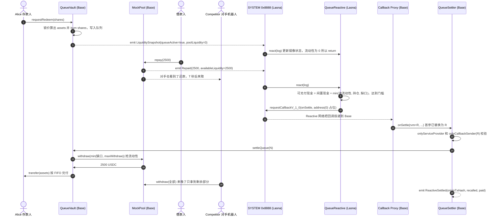
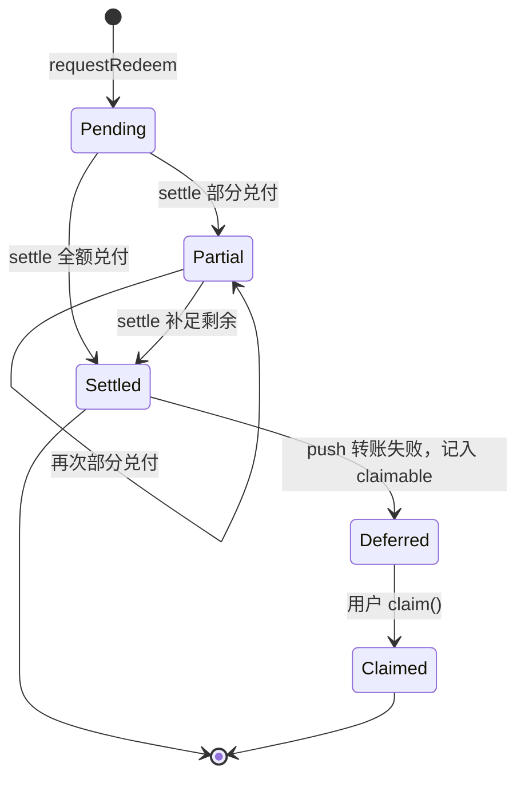
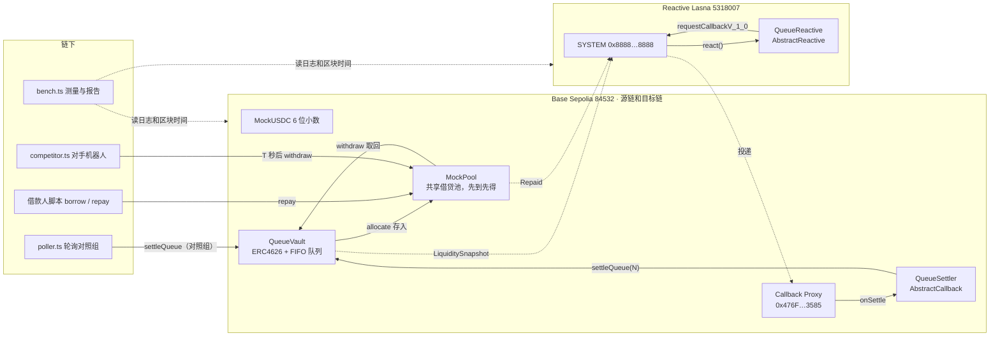
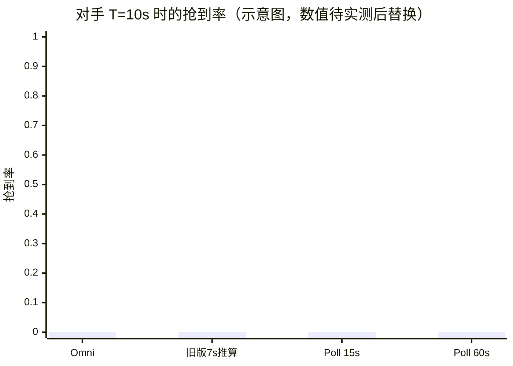

# ⚡ 即时结算提款队列（Instant-Settle Withdrawal Queue）产品与技术方案

> 赛事：Reactive Omni Buildathon · **赛道 1 Every Second Counts**
> 网络：Base Sepolia（84532，源链和目标链）↔ Reactive Lasna（5318007）
> 版本：**v0.2（2026-11-22）** · 状态：方案评审稿，还没开始写代码
> 标记约定：🔎 **待核实** = 部署或实测前必须再确认的事实，本文不替它编数字

> 📝 **v0.2 变更**：借贷模型从“借款人直接还钱给金库”（MockBorrower）改成 **共享资金池里先到先得**（MockPool）。原因是 v0.1 里钱回到金库后就一直在那里，晚几秒兑付只是体验差一点，撑不起赛道 1 要的“每一秒都重要”。v0.2 让晚到的一方真的会**丢失流动性**，并新增“抢流动性实验”（9.5 节）来量化这一点。受影响的章节：0、1、3、4、5、6、7.3–7.6、8、9、10、11、12、13。

---

## 0. TL;DR（先看这一屏）

| 问题 | 结论 |
|---|---|
| 做什么 | 一个 ERC4626 金库：把大部分资金存进**共享借贷池**生息。提款时现金不够就进入 FIFO 队列；**借款人一还款，池里出现流动性，Reactive 就在秒级把它取回金库并按 FIFO 兑付** |
| 为什么必须用 Reactive | ① 还款打进的是**别人的池子**，金库的代码一行都不会执行，没法在同一笔交易里结算；② 池里的流动性是**先到先得**，其他存款人的机器人也在抢，必须有一个“看得见事件、能马上上链”的角色。Reactive 做到这一点不需要服务器，也不需要私钥 |
| 为什么离不开 Omni 的 1 秒出块 | 用**抢流动性实验**证明：在“对手 T 秒后取走池中资金”的设定下，测出 Omni / 旧版约 7 秒出块（推算）/ 轮询机器人三种方案各抢到多少回流资金。抢不到的后果是排队用户要等**下一次还款**，可能是几小时到几天 |
| 六个关键取舍 | ① **锁价 + 申请时立即销毁份额** ② **虚拟份额（offset=6）+ 部署时种子存款**，舍入一律有利于金库 ③ **head/tail + mapping 的 FIFO，允许队首部分兑付**；**一次取回全部缺口，再分批兑付** ④ **settleQueue（取回 + 兑付）不设权限**，回调是快通道，任何人都能兜底 ⑤ **MockPool**（精简版 Aave：存款人份额 + 一个借款人 + 线性计息 + 提款受流动性限制）加一个 **Competitor 对手机器人** ⑥ **回调次数上限 + 自动退订 + 熔断 + debt 巡检** |
| 第几天必须跑通链路 | **D3（11/24）** 链上必须查到完整的三笔交易 |
| 演示时间 | D7（11/28）录好视频，11/29 Demo Day，12/5 前在 DoraHacks 提交 |

> 🏁 **竞品情况**（调研分支在 11/21 检索了全部 63 个 Build）：**没有人做提款队列或 ERC4626**；赛道 1 的项目大多集中在止损止盈。这个方向有稀缺性，而且本身就在官方 ideas 列表里（“Withdrawal queues that settle the moment they can”）。

---

## 1. 一句话概述与核心价值

**一句话**：借贷池里的流动性一出现，就在几秒内替排队用户抢回来并兑付，抢得比其他存款人的机器人快，同时不用跑服务器、不用托管私钥。

| 核心价值 | 面向谁 | 说明 |
|---|---|---|
| 🥇 抢到流动性 | 存款人 | 高利用率的资金池里，还款带来的流动性很快会被其他存款人取走。抢到了就是当场兑付，没抢到就要等下一次还款（几小时到几天） |
| 🏃 秒级退出 | 存款人 | 抢回后立即按 FIFO 兑付，端到端目标是几秒（🔎 以实测为准） |
| 💰 更高资金利用率 | 金库管理人 | 退出路径越可靠，需要的现金缓冲越少，借出去的比例就越高 |
| 🧹 零运维 | 金库管理人 | 不需要 keeper 服务器、热钱包和 cron；规则开源，可以审计 |
| ⚖️ 可验证的公平 | 所有人 | FIFO 顺序、价格和兑付上限都写在合约里；排队资金不会被插队的即时提款拿走 |

> 🧑‍💻 **Java/TS 类比**：共享池就像一个多人抢的库存（秒杀）：库存一补货，谁的请求先到谁就拿走。金库相当于基金申购赎回系统；Reactive 相当于托管在链上的 **Kafka consumer + webhook**。我们比的是“补货通知到下单成功”的端到端耗时。

---

## 2. 用户画像与痛点

### 2.1 用户画像

| 角色 | 典型诉求 | 现在的痛点 |
|---|---|---|
| 👩 存款人 Alice | 平时赚利息，要用钱时尽快取出 | 池子利用率接近 100% 时取不出来。偶尔有还款带来一点流动性，又被别人的机器人抢先取走 |
| 🧑‍💼 金库管理人 Bob | 尽量多借出去，同时不让用户提款卡住 | 想抢流动性就得自己运维机器人和热钱包，被盗或宕机都是风险 |
| 🏦 集成方（其他协议持有金库份额） | 退出路径可预期 | 退出时间不确定，风控只能按最坏情况估 |

### 2.2 与机器人方案对比

| 维度 | 🤖 定时轮询机器人（cron + EOA） | 🛰️ 事件驱动 WS 机器人（自建） | 🔁 Reactive Omni（本项目） |
|---|---|---|---|
| 触发方式 | 每 P 秒查一次池子流动性 | 订阅 WebSocket 日志 | 订阅链上事件，系统合约调用 `react()` |
| 延迟 | 平均约 P/2 + 上链时间 | 亚秒到秒级，取决于 RPC | 约 2 个 Reactive 区块 + 投递时间（🔎 待实测） |
| 抢流动性 | P 大时基本抢不到 | 能抢到 | 对手比我们慢时能抢到（9.5 节实测） |
| 基础设施 | 服务器、进程守护、告警 | 服务器、WS 断线重连、告警 | **无**，只有链上合约 |
| 私钥风险 | 热钱包私钥放在服务器上 | 同左 | **无私钥**：回调由 Reactive 网络签名，经 Callback Proxy 鉴权 |
| 单点故障 | 机器挂了就抢不到 | 同左，WS 断线还可能漏事件 | 由 Reactive 网络执行，另有**任何人可调用**的兜底入口 |
| 逻辑透明度 | 链下代码，不可验证 | 同左 | 合约开源，在 Reactscan 上可查每次 react |

> 🎯 **诚实结论**：
> - 写得好的 WS 机器人在延迟上可以和 Reactive 打平；同一个区块内抢跑的 MEV 搜索者更快，任何跨链自动化都比不过。
> - Reactive 胜在**没有服务器、没有私钥、逻辑可验证**。Omni 的约 1 秒出块，让它**第一次**能赢过绝大多数非 MEV 级别的竞争者；旧版约 7 秒出块做不到。
> - 我们的数据会同时和轮询机器人、WS 机器人对比，不只挑最弱的对手。

---

## 3. MVP 功能范围（Must / Should / Won't）

### ✅ Must（D6 前全部完成，缺一项就不能演示）

| # | 功能 | 验收标准 |
|---|---|---|
| M1 | `QueueVault`：OZ ERC4626 + MockUSDC（6 位小数），`_decimalsOffset()=6`，部署脚本里做种子存款 | 舍入测试全部通过 |
| M2 | 即时提款受 `instantCash()` 限制，不能挪用排队资金 | 队列非空时 `maxWithdraw` 只能用超出队列负债的现金 |
| M3 | `requestRedeem`：锁价、立即销毁份额、进入 FIFO 队列 | 请求前后每份额价格（PPS）不下降 |
| M4 | `settleQueue(maxCount)`：任何人可调用；**先从池里取回缺口（取不到也不 revert）**，再按 FIFO 兑付，队首可部分兑付；push 转账失败时转成 claimable | 幂等性测试和不变量测试通过 |
| M5 | `MockPool`：多存款人份额、单一借款人、线性计息、**提款受池内流动性限制（先到先得）**，还款时发出 `Repaid(availableLiquidity)` | 两个存款人抢同一笔流动性的测试通过 |
| M6 | `QueueReactive`（Lasna）：订阅金库快照和池子还款两类事件，维护镜像状态，判断阈值，有回调次数上限并自动退订 | 本地 MockSystem 测试通过，链上查得到 react |
| M7 | `QueueSettler`（Base Sepolia）：继承 `AbstractCallback`，同时加 `onlyServiceProvider` 和 `onlyCallbackSender` | 伪造调用一律 revert |
| M8 | 部署脚本，一条命令跑完整条链路 | 新人照 README 操作，30 分钟内能复现 |
| M9 | **延迟基准**（Reactive 至少 30 个样本）+ **抢流动性实验**（对手延迟 3 档 × 方案 2 档以上，每格 10 个样本），以及 `competitor.ts` 对手机器人 | 输出中位数、P95 表、抢到率表和 CSV |
| M10 | `status.sh`：打印 balance、reserves、debt 和剩余回调次数 | 一条命令能看出“合约是不是活着” |
| M11 | README、3 分钟演示视频、提交包 | 符合 DoraHacks 提交项 |

### 🟡 Should（时间够再做，按优先级排）

| # | 功能 | 价值 |
|---|---|---|
| S1 | `watch.ts`：终端里实时显示三段交易、对手动作和耗时 | 演示观感大幅提升 |
| S2 | WS 事件驱动机器人作为第三个对照组 | 对比更诚实，Integration 加分 |
| S3 | 只读网页看板（单个 HTML + viem，不接钱包），冲刺周再做 | 视频更直观 |
| S4 | 熔断：60 秒内 react 次数超过阈值就自动退订 | 防止被刷事件耗尽预算 |
| S5 | Reactive 侧“在途去重”（同一个 head 30 秒内不重复请求回调） | 省回调费 |
| S6 | 在 Unichain Sepolia 再部署一套，做延迟对比 | 赛道 1 允许两条链都用 |

### ❌ Won't（这次明确不做，演示时主动说明）

| 不做 | 原因 |
|---|---|
| 完整的 ERC-7540 合规（operator、ERC-165、claim 两段式） | 本项目“自动 push 兑付”本来就有意偏离 7540 的 claim 模式 |
| 取消排队请求 | 取消后用什么价格重铸份额，会引入新的套利面 |
| 坏账、损失分摊（按 min(申请价, 兑付价) 结算） | Mock 池不会出现坏账，放到路线图 |
| 对接真实的 Aave / Morpho | 测试网流动性和时间都不允许；MockPool 只保留“流动性先到先得”这一个关键特性 |
| 和同一区块内抢跑的 MEV 机器人比速度 | 跨链自动化不可能赢，诚实写进局限 |
| 能连接钱包的完整 DApp、主网部署、合约可升级、keeper 激励 | 超出范围 |

---

## 4. 用户流程

### 4.1 五条主流程

| 流程 | 触发者 | 链上动作 | 结果 |
|---|---|---|---|
| A 存款 | 用户 | `deposit(assets, receiver)` | 获得份额；如果队列活跃，就发出快照，可能触发兑付 |
| B 即时提款 | 用户 | `redeem` / `withdraw`（受 `maxRedeem` / `maxWithdraw` 限制） | 当场到账 |
| C 资金配置 | 管理人 | `allocate(assets)` | 把闲置现金存进 MockPool 生息（只能动缓冲以外的部分） |
| D 排队 + 抢流动性 + 自动兑付 ⭐ | 用户 → 借款人 → Reactive | `requestRedeem` → `pool.repay` → `react()` → `onSettle` → `settleQueue`（取回 + 兑付） | 秒级到账；与对手机器人竞争 |
| E 兜底手动结算 | 任何人 | `settleQueue(maxCount)` | 和流程 D 结果相同，用于 Reactive 不可用的情况 |

### 4.2 核心时序（流程 D：抢流动性）



> ⏱️ 如果第 18 步（对手取款）发生在第 15 步（我们取回）之前，金库取回的就是 0，Alice 继续排队，等下一次还款。**这就是“每一秒都重要”的来源。**

### 4.3 单个请求的生命周期



---

## 5. 系统架构

### 5.1 架构图



### 5.2 三条链各部署什么

| 链 | chainId | 部署的合约或角色 | 资金 | 地址来源 |
|---|---|---|---|---|
| **Base Sepolia** | 84532 | MockUSDC、MockPool、QueueVault、QueueSettler；EOA：借款人、对手、演示用户 | ETH：部署 gas + Settler 回调费（约 0.03 ETH） | Callback Proxy `0x476F44b11F5C942c58f4c8E3d0300E5710743585`（2026-11-21 已对照 [官方页](https://dev.reactive.network/origins-and-destinations) 核实） |
| **Reactive Lasna** | 5318007 | QueueReactive | lREACT：约 8（用于 react 计费，见 7.6） | SYSTEM `0x8888888888888888888888888888888888888888`（omni 库常量，已核实） |
| Ethereum Sepolia | 11155111 | **不部署合约**，只用来换 lREACT | Sepolia ETH 转给 faucet `0x9b9BB25f1A81078C544C829c5EB7822d747Cf434` | 速查表 11/08 核对；🔎 部署前再核实一次 |
| （S6 可选）Unichain Sepolia | 1301 | 同 Base 的一套 | ETH | Proxy `0x775c9B990ADe401060B78D0e98684eEf8d2466C1`（2026-11-21 已核实） |

> 🔎 Base Sepolia 上也有 lREACT faucet（速查表记录为 `0x2afaFD298b23b62760711756088F75B7409f5967`），使用前请再核实一次。

### 5.3 为什么金库不能自己结算？（评委一定会问）

| 理由 | 说明 |
|---|---|
| ① 流动性出现在别人的合约里 | 借款人把钱还给 **MockPool**，金库的代码一行都没执行。真实世界里也是这样：Aave / Morpho 的还款进的是市场，不是你的金库 |
| ② 流动性先到先得 | 池里的钱谁先 `withdraw` 就归谁。就算金库能被通知到，也必须**赶在别人之前**发出交易 |
| ③ gas 外部化 | 让存款人或还款人顺手兑付 N 笔，会让他们为别人的转账付 gas，集成方也没法预估 gas |
| ④ 可扩展到跨链 | 流动性可能在另一条链上出现（例如 Arbitrum 上的市场），Reactive 天然支持跨链监听 |

> 🧑‍💻 **Java 类比**：这就像别的服务的库存表补货了，你的服务收不到任何回调，只能靠订阅它的变更日志（CDC / binlog）。而且补货只有一小份，谁先下单谁拿走。

---

## 6. 合约设计

> 依赖：`reactive-lib-omni`（`@reactive/src/...`）、OpenZeppelin Contracts v5.x（ERC4626、Ownable、ReentrancyGuard、SafeERC20；🔎 版本号在 `forge install` 后锁定）、Solidity `^0.8.29`、`evm_version = cancun`。
> 建议目录：新建 `queue-vault/` Foundry 工程，`src/`、`test/`、`script/`、`bench/`（TypeScript + viem）都放在里面。

### 6.1 事件契约（先定事件，再写合约）

> 💡 react() 读不到 Base 上的状态，所以**事件必须携带判断所需的全部数据**。这就是 Event-Carried State Transfer 模式：Kafka 消息里直接带完整快照，消费者不需要回源查库。

| 事件 | 发出方 | indexed（topic） | data 字段 | 订阅过滤 |
|---|---|---|---|---|
| `LiquiditySnapshot` | QueueVault | `bool queueActive`（topic1），`uint8 reason`（topic2） | `seq, queueCash, poolPosition, poolLiquidity, headId, headRemaining, totalQueued, totalClaimable, pendingCount, timestamp`（共 10 个字段） | topic1 = 1，只在队列活跃或刚被清空时投递 |
| `Repaid` | MockPool | `address payer`（topic1） | `amount, availableLiquidity, timestamp` | 只按池子地址和 topic0 过滤 |
| `LiquidityTaken` | MockPool | `address lender`（topic1） | `amount, availableAfter, timestamp` | 不订阅，实验用来统计谁抢到了多少 |
| `SettleRequested` | QueueReactive（Lasna） | `uint256 originTxHash` | `source, seq, cashForQueue, headRemaining, maxCount` | 不订阅，用来测延迟 |
| `ReactiveSettled` | QueueSettler（Base） | `uint256 originTxHash` | `source, seq, recalled, processed, paid, newHead, timestamp` | 不订阅，用来测延迟 |

- `queueActive = pendingCount > 0 || 本次操作恰好清空了队列`。队列空闲时的存款不会投递到 Lasna，**不产生 react 费用**；队列清空的那一刻仍然投递一次，让镜像状态归零。
- `reason`：1=DEPOSIT，2=REQUEST，3=SETTLED。
- `poolPosition` = 金库在池中的资产价值；`poolLiquidity` = 池中当前可取的现金（`asset.balanceOf(pool)`）。
- topic0 部署时用 `cast keccak "LiquiditySnapshot(bool,uint8,uint256,uint256,uint256,uint256,uint256,uint256,uint256,uint256,uint256,uint64)"`（9 个 uint256）和 `cast keccak "Repaid(address,uint256,uint256,uint64)"` 计算，**不在文档里手写哈希**。

### 6.2 MockPool（Base Sepolia，测试网专用的“精简版 Aave”）

`contract MockPool is ERC4626, Ownable`（份额记账直接复用 ERC4626；存款人拿到池份额）

| 状态变量 | 说明 |
|---|---|
| `borrower` | 唯一借款人（EOA），只能设置一次 |
| `principal`、`accruedInterest`、`lastAccrual`（uint64 时间戳）、`aprBps`（默认 800） | 借款人负债，按 `block.timestamp` 线性计息（Base 200ms 出块，**不用区块数**） |

| 函数 | 说明 |
|---|---|
| `owed() view` | `principal + accruedInterest + principal * aprBps * (now - lastAccrual) / (10_000 * 365 days)`，向下取整 |
| `totalAssets() view override` | `asset.balanceOf(this) + owed()` |
| `maxWithdraw(o) / maxRedeem(o) view override` | 再和 `asset.balanceOf(this)` 取 min。**这就是“先到先得”**：谁先调用，谁拿走现金 |
| `borrow(uint256 amt)` | `onlyBorrower`：`_accrue()`，`amt <= 流动性`，`principal += amt`，转给借款人 |
| `repay(uint256 amt)` | 任何人都能还：`_accrue()`，`transferFrom`，先抵利息再抵本金；`emit Repaid(msg.sender, amt, asset.balanceOf(this), now)` |
| `_withdraw(...) override` | `super` 后 `emit LiquidityTaken(owner, assets, asset.balanceOf(this), now)` |

> 📐 借款人还款时现金增加 x、负债减少 x，**池子的 PPS 不变**；利息随时间平滑计入。借款人需要付的利息用 `MockUSDC.mint` 补足，只在测试网这样做，README 里会写明。

### 6.3 QueueVault（Base Sepolia）

`contract QueueVault is ERC4626, Ownable, ReentrancyGuard`

**状态变量**

| 变量 | 类型 | 说明 |
|---|---|---|
| `pool` | `IMockPool`（immutable） | 资金配置的去处 |
| `requests` | `mapping(uint256 => RedeemRequest)` | 队列存储，相当于 `HashMap<Long, Request>` |
| `head` / `tail` | `uint256` | `[head, tail)` 就是队列；head 只增不减 |
| `totalQueuedAssets` | `uint256` | Σ 所有请求的 `assetsRemaining`（队列负债） |
| `claimable` / `totalClaimable` | `mapping` / `uint256` | push 失败后转成 pull 的待领余额 |
| `snapshotSeq` | `uint256` | 快照单调序号，用于去重和延迟关联 |
| `minRequestAssets` | `uint256` | 最小排队金额，防刷请求（演示取 1 USDC） |
| `bufferBps` | `uint16` | allocate 后至少保留的闲置现金比例（演示取 500，即 5%） |
| `MAX_SETTLE_PER_CALL` | `uint256 constant` | 单次兑付笔数的硬顶 50，防止无界循环 |

```solidity
struct RedeemRequest {
    address owner;
    address receiver;
    uint128 assetsTotal;      // 锁定的应付资产
    uint128 assetsRemaining;  // 剩余待付
    uint64  requestedAt;      // block.timestamp
    uint64  settledAt;
}
```

**四种现金口径**（整个设计的核心）

| 口径 | 公式 | 用途 |
|---|---|---|
| `cash` | `asset.balanceOf(this)` | — |
| `poolPosition()` | `pool.previewRedeem(pool.balanceOf(this))` | 计入 `totalAssets` |
| `queueCash()` | `cash - totalClaimable` | `settleQueue` 兑付队列 |
| `instantCash()` | `max(0, cash - totalClaimable - totalQueuedAssets)` | 即时提款、`allocate` |

`totalAssets() = cash + poolPosition() - totalQueuedAssets - totalClaimable`（饱和减法）

> ⚖️ 排队请求先占用现金，即时提款只能用“队列全部付清后还剩的钱”。从池里抢回来的现金在下一轮兑付前，也不会被插队的人拿走。

**函数签名**

| 函数 | 修饰符 | 说明 |
|---|---|---|
| `constructor(IERC20 asset_, IMockPool pool_, uint256 minRequestAssets_, uint16 bufferBps_)` | — | `head = tail = 1` |
| `_decimalsOffset() internal pure override` | — | `return 6;` |
| `maxWithdraw / maxRedeem view override` | — | 再和 `instantCash()` 取 min |
| `_deposit(...) internal override` | — | `super._deposit` 后调用 `_snapshot(DEPOSIT)` |
| `requestRedeem(uint256 shares, address receiver, address owner) returns (uint256 id)` | `nonReentrant` | 锁价、burn 份额、入队、发快照 |
| `settleQueue(uint256 maxCount) returns (uint256 recalled, uint256 processed, uint256 paid)` | `nonReentrant`，**不设权限** | ① 从池里取回缺口 ② FIFO 兑付；没有工作可做时直接 return |
| `claim() returns (uint256)` | `nonReentrant` | 领取 push 失败后的余额 |
| `allocate(uint256 assets)` | `onlyOwner nonReentrant` | 只能动 `instantCash` 里超出缓冲的部分，存入池子 |
| `queueCash() / instantCash() / poolPosition() / pendingCount() / getRequest(id)` | `view` | 给 react、脚本和测试用 |

**事件**

```solidity
event RedeemRequested(uint256 indexed id, address indexed owner, address indexed receiver, uint256 shares, uint256 assets, uint64 requestedAt);
event Recalled(uint256 wanted, uint256 got, uint256 poolLiquidityAfter);   // 抢流动性的结果
event RecallFailed(bytes reason);                                           // 池子异常时不阻断兑付
event RedeemSettled(uint256 indexed id, address indexed receiver, uint256 paid, uint256 remaining, bool done);
event PayoutDeferred(uint256 indexed id, address indexed receiver, uint256 amount);
event SettleSkipped(uint256 head, uint256 queueCash);
event Allocated(uint256 assets, uint256 cashAfter);
event LiquiditySnapshot(bool indexed queueActive, uint8 indexed reason, uint256 seq, uint256 queueCash,
    uint256 poolPosition, uint256 poolLiquidity, uint256 headId, uint256 headRemaining,
    uint256 totalQueued, uint256 totalClaimable, uint256 pendingCount, uint64 timestamp);
```

**关键伪代码**

```solidity
function requestRedeem(uint256 shares, address receiver, address owner) external nonReentrant returns (uint256 id) {
    if (receiver == address(0)) revert ZeroAddress();
    if (msg.sender != owner) _spendAllowance(owner, msg.sender, shares);
    uint256 assets = previewRedeem(shares);                 // Floor：有利于金库
    if (assets < minRequestAssets) revert RequestTooSmall();
    _burn(owner, shares);                                   // 立即销毁，PPS 不变
    id = tail++;
    requests[id] = RedeemRequest(owner, receiver, uint128(assets), uint128(assets), uint64(block.timestamp), 0);
    totalQueuedAssets += assets;
    emit RedeemRequested(id, owner, receiver, shares, assets, uint64(block.timestamp));
    _snapshot(REASON_REQUEST, false);
}

function settleQueue(uint256 maxCount) external nonReentrant returns (uint256 recalled, uint256 processed, uint256 paid) {
    bool wasActive = head < tail;
    // ① 抢流动性：一次取回“全部缺口”，不受 maxCount 限制（先把钱拿到手，兑付可以分批）
    uint256 qc = queueCash();
    if (totalQueuedAssets > qc) {
        uint256 want = totalQueuedAssets - qc;
        uint256 take = min(want, pool.maxWithdraw(address(this)));  // 受池子流动性限制
        if (take > 0) {
            try pool.withdraw(take, address(this), address(this)) { recalled = take; }
            catch (bytes memory err) { emit RecallFailed(err); }     // 池子异常也不阻断兑付
        }
        emit Recalled(want, recalled, IERC20(asset()).balanceOf(address(pool)));
    }
    // ② FIFO 兑付
    if (maxCount > MAX_SETTLE_PER_CALL) maxCount = MAX_SETTLE_PER_CALL;
    uint256 avail = queueCash();
    uint256 id = head;
    while (processed < maxCount && id < tail && avail > 0) {
        uint256 rid = id;
        RedeemRequest storage r = requests[rid];
        uint256 pay = min(r.assetsRemaining, avail);
        // —— Effects：先改完所有状态 ——
        r.assetsRemaining -= uint128(pay);
        totalQueuedAssets -= pay;
        avail -= pay; paid += pay; processed++;
        bool done = (r.assetsRemaining == 0);
        if (done) { r.settledAt = uint64(block.timestamp); id++; }
        head = id;                                          // CEI：转账前就推进指针
        // —— Interactions ——
        _payout(rid, r.receiver, pay);                      // 失败转成 claimable，不 revert
        emit RedeemSettled(rid, r.receiver, pay, r.assetsRemaining, done);
        if (!done) break;                                   // 现金已经用完
    }
    if (recalled == 0 && processed == 0) { emit SettleSkipped(head, queueCash()); return (0, 0, 0); }  // 幂等：不 revert
    _snapshot(REASON_SETTLED, wasActive);
}

function _payout(uint256 id, address to, uint256 amt) internal {
    (bool ok, bytes memory ret) = address(asset()).call(abi.encodeCall(IERC20.transfer, (to, amt)));
    if (!ok || (ret.length != 0 && !abi.decode(ret, (bool)))) {
        claimable[to] += amt; totalClaimable += amt;        // 一个坏的接收者不会卡住整条队列
        emit PayoutDeferred(id, to, amt);
    }
}

function _snapshot(uint8 reason, bool wasActive) internal {
    uint256 pending = tail - head;
    bool active = pending > 0 || wasActive;
    RedeemRequest storage h = requests[head];
    emit LiquiditySnapshot(active, reason, ++snapshotSeq, queueCash(), poolPosition(),
        IERC20(asset()).balanceOf(address(pool)), head, pending > 0 ? h.assetsRemaining : 0,
        totalQueuedAssets, totalClaimable, pending, uint64(block.timestamp));
}

function allocate(uint256 assets) external onlyOwner nonReentrant {
    uint256 floor = totalAssets() * bufferBps / 10_000;
    if (instantCash() < assets + floor) revert ExceedsAllocatable();  // 队列非空时 instantCash≈0，自动禁止配置
    IERC20(asset()).forceApprove(address(pool), assets);
    pool.deposit(assets, address(this));
    emit Allocated(assets, IERC20(asset()).balanceOf(address(this)));
}
```

### 6.4 QueueReactive（Lasna）

`contract QueueReactive is AbstractReactive`

| 状态变量 | 说明 |
|---|---|
| `OWNER`、`CHAIN_ID`（84532）、`VAULT`、`POOL`（immutable） | 构造时写定 |
| `SNAPSHOT_TOPIC0`、`REPAID_TOPIC0`（immutable，构造参数传入） | 由 `cast keccak` 计算 |
| `settler` | 目标链回调合约，部署后通过 `setSettler` 设置 |
| `maxPerCallback`（N）、`callbackGasLimit`、`minSettleAssets` | 可调参数；gasLimit 不能低于 100k，否则 revert |
| `remainingCallbacks` | 回调预算，归零时自动退订 |
| `subscribed`、`paused` | 订阅状态 |
| `mirror` | `struct { seq; queueCash; poolPosition; headId; headRemaining; totalQueued; pendingCount; }`，**Base 队列状态在 Lasna 上的镜像** |
| `inflightHead`、`inflightUntil`（S5） | 在途去重 |
| `reactCount`、`callbackCount` | 统计 |

| 函数 | 修饰符 | 说明 |
|---|---|---|
| `constructor(vault, pool, snapTopic0, repaidTopic0, n, gasLimit, minSettle, budget) payable` | — | 调用 `_subscribeAll()` |
| `react(LogRecord calldata log_)` | `onlySystem` | 主逻辑，**绝不 revert** |
| `setSettler(address)` | `onlyOwner` | — |
| `setParams(n, gasLimit, minSettle)` | `onlyOwner` | gasLimit 低于 100_000 时 revert |
| `topUp(uint256 budget) payable` | `onlyOwner` | 补预算：先 `_coverDebt()`，再重新订阅 |
| `pause() / resume()` | `onlyOwner` | 退订或重新订阅（参数必须和订阅时完全一致）；**跑轮询对照组时必须暂停** |
| `coverDebt()` | — | 对外包装基类的 `_coverDebt()` |

```solidity
// 伪代码：表达逻辑，不保证能直接编译（例如元组解构需要先声明变量）
function react(LogRecord calldata log_) external onlySystem {
    reactCount++;
    if (log_.chainId != CHAIN_ID || paused) return;
    uint256 poolLiquidity; uint8 source; uint256 seq;

    if (log_.contractAddress == VAULT && log_.topic0 == SNAPSHOT_TOPIC0) {
        if (log_.data.length != 10 * 32) return;                 // 防御：数据长度不对时 abi.decode 会 revert
        (seq, qc, pos, liq, headId, headRem, queued, , pending, ) = abi.decode(log_.data,
            (uint256,uint256,uint256,uint256,uint256,uint256,uint256,uint256,uint256,uint64));
        if (seq <= mirror.seq) return;                            // 过期或重复的快照
        mirror = Mirror(seq, qc, pos, headId, headRem, queued, pending);
        poolLiquidity = liq; source = SRC_SNAPSHOT;
    } else if (log_.contractAddress == POOL && log_.topic0 == REPAID_TOPIC0) {
        if (log_.data.length != 3 * 32) return;
        (, poolLiquidity, ) = abi.decode(log_.data, (uint256, uint256, uint64));
        source = SRC_REPAID;
    } else return;

    if (mirror.pendingCount == 0) return;                         // 队列为空
    // 可兑付现金 = 金库闲置现金 + 能从池里抢回的部分
    uint256 shortfall  = mirror.totalQueued > mirror.queueCash ? mirror.totalQueued - mirror.queueCash : 0;
    uint256 recallable = min3(poolLiquidity, mirror.poolPosition, shortfall);
    uint256 cashForQueue = mirror.queueCash + recallable;
    uint256 threshold = min(mirror.headRemaining, minSettleAssets);
    if (cashForQueue < threshold) { emit Skipped(log_.txHash, 1); return; }
    if (remainingCallbacks == 0 || settler == address(0)) return;
    // （S5）if (inflightHead == mirror.headId && block.timestamp < inflightUntil) return;

    if (--remainingCallbacks == 0) _unsubscribeAll();
    bytes memory payload = abi.encodeWithSignature(
        "onSettle(address,uint8,uint256,uint256,uint256)",
        address(0), source, seq, log_.txHash, maxPerCallback   // 首参 address(0) 占位，由网络替换成本合约地址
    );
    emit SettleRequested(log_.txHash, source, seq, cashForQueue, mirror.headRemaining, maxPerCallback);
    SYSTEM.requestCallbackV_1_0(ISystemContract.CallbackConfiguration_V_1_0({
        chainId: CHAIN_ID, recipient: settler, gasLimit: callbackGasLimit, payload: payload
    }));
}
```

> 🧠 **react() 承担的实际工作**（Integration 评分点）：融合两个事件源（金库快照 + 第三方池子的还款）、维护跨链镜像状态、丢弃过期快照、计算“可抢回的流动性”、判断阈值、管理预算和熔断、选择 N。**真正的业务决策在 Reactive 侧做，金库只负责陈述事实和执行。**

订阅（构造函数中）：

```solidity
SYSTEM.subscribe(CHAIN_ID, VAULT, SNAPSHOT_TOPIC0, 1,               REACTIVE_IGNORE, REACTIVE_IGNORE); // 只收 queueActive=true
SYSTEM.subscribe(CHAIN_ID, POOL,  REPAID_TOPIC0,   REACTIVE_IGNORE, REACTIVE_IGNORE, REACTIVE_IGNORE); // 池子的所有还款
```

### 6.5 QueueSettler（Base Sepolia）

`contract QueueSettler is AbstractCallback`

| 项 | 内容 |
|---|---|
| 状态 | `VAULT`（immutable）；继承得到 `_CALLBACK_SENDER`（immutable，等于 QueueReactive 地址，**填错只能重新部署**）和 `_SERVICE_PROVIDER`（等于 Proxy） |
| 构造 | `constructor(IPayable proxy_, address reactive_, IQueueVault vault_) payable AbstractCallback(proxy_, reactive_)` |
| 回调 | `onSettle(address rvm, uint8 source, uint256 seq, uint256 originTxHash, uint256 maxCount) external onlyServiceProvider onlyCallbackSender(rvm)` |
| 事件 | `event ReactiveSettled(uint256 indexed originTxHash, uint8 source, uint256 seq, uint256 recalled, uint256 processed, uint256 paid, uint256 newHead, uint64 timestamp)` |
| 运维 | `coverDebt()` 对外包装 |

```solidity
function onSettle(address rvm, uint8 source, uint256 seq, uint256 originTxHash, uint256 maxCount)
    external onlyServiceProvider onlyCallbackSender(rvm)
{
    (uint256 recalled, uint256 processed, uint256 paid) = VAULT.settleQueue(maxCount);  // 没有工作时返回 0，不 revert
    emit ReactiveSettled(originTxHash, source, seq, recalled, processed, paid, VAULT.head(), uint64(block.timestamp));
}
```

> 🔐 两道校验就像 webhook 的“来源 IP 白名单 + 签名校验”：`onlyServiceProvider` 检查 `msg.sender == Proxy`，`onlyCallbackSender(rvm)` 检查 Proxy 注入的首参是不是我们自己的 Reactive 合约。

> ❓ **为什么 Settler 要和金库分开？** ① 回调手续费（ETH）和用户资产（USDC）隔离；② 换 Reactive 合约时只需要重新部署 Settler，金库不动；③ 金库保持为一个干净的 ERC4626。代价是多一次外部调用，大约 2–3k gas。

---

## 7. 关键设计取舍

### 7.1 排队期间份额价格变化：用哪个价格？份额怎么处理？

**价格口径**

| 方案 | 做法 | 优点 | 缺点 |
|---|---|---|---|
| **A 锁定申请价** ⭐ | 申请时 `assets = previewRedeem(shares)`，之后固定不变 | 负债确定，react 能精确算出缺口；不变量简单 | 排队期间不再享受收益（用户本来就已选择退出）；发生坏账时排队者能躲过损失 |
| B 兑付时价格 | 兑付时按当时 PPS 换算 | 排队者和留下的人风险收益一致 | 缺口一直在变，事件里的数据会过时；份额必须托管 |
| C min(申请价, 兑付价) | Lido 提款队列的思路 | 防止“预见坏账就抢先排队”的逆向选择 | 实现复杂；Mock 池没有坏账，演示不出区别 |

**份额处理**

| 方案 | 做法 | 评价 |
|---|---|---|
| **立即销毁** ⭐ | 申请时直接 `_burn` | 配合方案 A：`totalSupply` 和 `totalAssets` 同步减少，PPS 不下降，实现最简单 |
| 托管 | 转给金库，兑付时再 burn | 方案 B 必须这样做；托管的份额还在 `totalSupply` 里，要特别处理 |
| 锁定 | 份额留在用户名下，但禁止转账 | 要改 ERC20 的 `_update`，和 DeFi 集成冲突 |

**✅ 推荐：A + 立即销毁**；方案 C 作为路线图（加入坏账上报以后再做）。

📐 **PPS 不下降的证明**：设原来的资产为 A、份额为 S，申请赎回 s 份，`a = floor(s·A/S) ≤ s·A/S`。新的 PPS = (A−a)/(S−s) ≥ (A − s·A/S)/(S−s) = A/S ∎（虚拟份额只会让不等式更宽松）

### 7.2 通胀攻击防护与舍入方向

**攻击回顾**：攻击者先存 1 wei 拿到 1 份，再直接 `transfer` 大量资产“捐赠”给金库，把 PPS 抬到极高。之后受害者存款算份额时向下取整成 0，钱就被攻击者吞了。

| 方案 | 原理 | 优点 | 缺点 |
|---|---|---|---|
| **虚拟份额 `_decimalsOffset()`** ⭐ | OZ v5 内置：计算时分子分母都加上虚拟份额和虚拟资产 | 不需要额外流程；offset=6 时攻击者自身的损失约为受害者损失的 10⁶ 倍，攻击无利可图 | 极少量价值被虚拟份额“吃掉”（可忽略） |
| **部署时种子存款（dead shares）** ⭐ | 部署脚本存入 1 USDC，份额 mint 给 `0x…dEaD` | 让第一次存款不在空金库上发生 | 需要部署人付出 1 USDC 测试币 |
| 内部记账（不用 balanceOf） | 自己维护闲置现金，捐赠不计入资产 | 从根上免疫捐赠 | 每条资金路径都要同步记账，容易出错 |
| 最小存款额 | 小额存款直接 revert | 简单 | 只能减缓，挡不住 |

**✅ 推荐：offset=6 + 种子存款**，两层防护，都是现成方案。MockPool 同样设置 offset。

**舍入方向**（原则：**永远有利于金库，也就是有利于留下来的人**）

| 入口 | 计算 | 舍入 | 理由 |
|---|---|---|---|
| `deposit(assets)` | 发给用户的 shares | ⬇️ Floor | 少发份额 |
| `mint(shares)` | 向用户收的 assets | ⬆️ Ceil | 多收资产 |
| `withdraw(assets)` | 销毁的 shares | ⬆️ Ceil | 多烧份额 |
| `redeem(shares)` | 付给用户的 assets | ⬇️ Floor | 少付资产 |
| `requestRedeem(shares)` | 锁定的 assets | ⬇️ Floor（复用 `previewRedeem`） | 和 redeem 一致 |
| `maxRedeem` 换算 instantCash | `convertToShares(instantCash)` | ⬇️ Floor | 不能让 maxRedeem 超出现金 |
| `poolPosition()` | `pool.previewRedeem` | ⬇️ Floor | 不高估在池中的资产 |
| 从池里取回 | `pool.withdraw(assets)` 销毁池份额 | ⬆️ Ceil（池子的规则） | 金库最多亏 1 wei 量级，可接受 |

> 🧑‍💻 **Java 类比**：就像银行系统里 `BigDecimal.setScale(2, RoundingMode.DOWN)` 统一用于“付给客户”的方向，`UP` 统一用于“向客户收取”的方向。

### 7.3 队列数据结构与单次上限 N

**数据结构**

| 方案 | 入队 / 出队 | 部分兑付 | 评价 |
|---|---|---|---|
| **head/tail 指针 + mapping** ⭐ | O(1) / O(1) | 支持（修改队首的 remaining） | 和 `ArrayDeque` 的思路一样；历史记录可查；不用搬移数据 |
| 动态数组 + 删除首元素 | O(1) / O(n) | 支持 | 删除首元素要整体搬移，gas 爆炸 ❌ |
| 链表 | O(1) / O(1) | 支持 | 能做“取消请求”，但我们不做取消，属于过度设计 |
| 按用户聚合的 mapping | — | — | 失去 FIFO 顺序 ❌ |

**队首现金不够时怎么办？**

| 方案 | 行为 | 评价 |
|---|---|---|
| 全有或全无 | 现金 < 队首金额就停 | 一笔大额请求会堵住整个队列（队头阻塞） |
| 跳过大额，先付后面的小额 | 不再是 FIFO | 不公平 ❌ |
| **部分兑付队首** ⭐ | 有多少付多少，队首的 remaining 相应减少 | 现金利用率最高，严格 FIFO，不会饿死任何请求 |

为了不让 1 wei 的流动性也触发回调，react 的触发门槛是 `min(队首剩余, minSettleAssets)`。

**取回和兑付分开限额** ⭐（v0.2 新增）

| 步骤 | 上限 | 理由 |
|---|---|---|
| 从池里取回 | **全部缺口**（受池子流动性限制），**不受 N 限制** | 抢流动性是在和对手赛跑，必须一次拿到手；一次 `withdraw` 的 gas 是固定的 |
| FIFO 兑付 | 最多 N 笔 | 每笔一次转账，gas 线性增长，需要设上限 |

**N 的取值依据**（D2 用 `forge test --gas-report` 实测校准）

```
callbackGasLimit ≥ (Settler 固定开销 + 池子 withdraw 开销 + N × 单笔兑付 gas) × 1.3 安全系数 + Proxy 记账开销
```

| 参数 | 初值 | 依据 |
|---|---|---|
| 单笔兑付 gas | 约 60–80k（🔎 待实测） | 读写 2 个存储槽 + ERC-20 transfer（冷账户）+ 一个事件 |
| 池子 withdraw | 约 80–120k（🔎 待实测） | ERC4626 withdraw + 计息 + 事件 |
| **N（maxPerCallback）** | **10** | 演示场景一次回流通常够付 1–5 笔 |
| callbackGasLimit | 1,500,000（🔎 待实测后调整） | 大于 100k 下限，远低于 Base 的区块 gas 上限 |
| `MAX_SETTLE_PER_CALL` | 50 | 合约硬顶，防止人工兜底调用时传入一个巨大的 maxCount |

**剩余请求怎么在下一次继续？事件自续** 🔁

1. 钱已经全部抢回金库，所以剩下的只是“分批兑付”，不会再丢流动性
2. 一次兑付满 N 笔后，金库发出 `LiquiditySnapshot(reason=SETTLED, queueActive=true)`，此时 `queueCash` 仍然 ≥ 门槛
3. react 收到后再请求一次回调；每一轮 head 都严格前进，循环一定会终止：要么现金用完，要么队列清空，要么回调预算耗尽

### 7.4 settleQueue 的权限、幂等与重入

| 方案 | 安全性 | 活性（会不会卡住） | 评价 |
|---|---|---|---|
| 只允许回调调用 | 最严格 | Reactive 欠费或宕机时队列就卡死 ❌ | 单点故障 |
| 回调 + 白名单 keeper | 中等 | 依赖 keeper | 又回到“机器人”老路 |
| **任何人都能调用** ⭐ | 取回金额 = min(缺口, 池子流动性)，兑付按 FIFO 和锁定价格，**结果只由链上状态决定，谁来调用都一样** | 任何人都能兜底 ✅ | 调用者自己付 gas；兑付硬顶 50 笔 |

**✅ 推荐：settleQueue 不设权限。** 回调走 Settler 是快通道，人工或任意第三方调用是兜底。

- ❓ “任何人都能逼金库从池里取钱，会不会损失收益？” 不会。取回金额最多等于**队列缺口**，这本来就是欠用户的钱，取回只是兑现负债。缺口以外的资金一分不动。
- 真正需要鉴权的只有 Settler 的 `onSettle`，防止有人伪造“Reactive 来源”污染延迟统计。

**幂等与重入防护**

| 风险 | 防护 |
|---|---|
| 同一请求被付两次 | `head` 只增不减；`assetsRemaining` 只减；每个请求累计付款不会超过 `assetsTotal` |
| 两个回调先后落地 | 第二个回调读到的是最新状态：缺口为 0 就不取回，没有可付的就 `emit SettleSkipped` 并 return，**不 revert**（因为 revert 照样收费） |
| 池子被对手抢空 | `maxWithdraw` 已经反映了实时流动性，取回 0 不会 revert |
| 池子异常 revert | `try/catch` 包住 `pool.withdraw`，兑付闲置现金不受影响 |
| 重入 | `nonReentrant` + CEI（先推进 head 和余额再转账）；MockUSDC 没有转账钩子，但仍然按“未来可能换成带钩子的代币”来防 |
| 坏接收者阻塞队列 | push 失败转成 `claimable`，队列照常前进 |

> 🧑‍💻 **Java 类比**：`settleQueue` 就像一个“对账 Job”，谁触发都只做“把能结的结掉”。head 指针相当于 Kafka consumer 只增不减的 committed offset。

### 7.5 “借出生息”在测试网上怎么模拟

| 方案 | 真实度 | 能不能体现“每一秒都重要” | 工作量 | 评价 |
|---|---|---|---|---|
| 对接测试网上的 Aave / Morpho | 高 | 能 | 高；测试网流动性和地址不稳定 🔎 | 7 天内风险过大 ❌ |
| 金库内部“假装借出”，只改数字 | 低 | 不能 | 低 | 资金没有真实流动，Reactive 没有真实事件可听 ❌ |
| v0.1 的 MockBorrower（还款直接回金库） | 中 | **弱**：钱回到金库就一直在那里，晚到只是体验差 | 低 | 赛道 1 论证不足 ❌ |
| **v0.2 MockPool + Competitor** ⭐ | 中高：多存款人共享池、流动性先到先得、按时间计息 | **强**：晚到会真的丢失流动性 | 中（池子约 120 行，对手脚本约 60 行） | ✅ |

**✅ 推荐 MockPool + Competitor**

| 角色 | 实现 | 行为 |
|---|---|---|
| MockPool | 精简版 Aave，复用 OZ ERC4626 记账 | 多人存款，单一借款人，提款受流动性限制 |
| 借款人 | EOA 脚本 | 把池子借到利用率接近 100%，按实验节奏 `repay` |
| Competitor 对手 | EOA + `competitor.ts` | 也是池子的存款人；用 WS 监听 `Repaid`，**等 T 秒后**取走自己能取的全部流动性 |
| 我们的金库 | QueueVault | 通过 Reactive 回调（或对照组的轮询机器人）取回缺口 |

> 📌 对手的 T 是**实验变量**（3s / 10s / 30s），用来画出“对手多快时我们还能赢”的曲线。真实世界里对手的延迟分布我们不知道，所以只把它作为相对比较，不宣称真实市场的胜率。

### 7.6 Reactive 侧预算：次数上限、退订时机、余额监控

| 机制 | 方案 | 选择 |
|---|---|---|
| 回调次数上限 | `remainingCallbacks`，归零时自动退订两个订阅 | ✅ Must |
| 在途事件保护 | 退订后仍可能有事件在路上：`remainingCallbacks == 0` 时直接 return | ✅ Must |
| 暂停开关 | `pause()` 退订，`resume()` 用完全相同的参数重新订阅 | ✅ Must（跑轮询对照组时必须暂停） |
| 订阅源头过滤 | 金库快照只投递 `queueActive=true` 的 | ✅ Must（最省钱的一招） |
| 熔断 | 60 秒窗口内 react 次数超过 X 就自动退订，并 emit `CircuitBreak` | 🟡 S4 |
| 在途去重 | 同一个 head 30 秒内不重复回调 | 🟡 S5 |
| Cron 心跳 | 每个 tick 都收费 | ❌ 不用 |
| 监控 | `status.sh`：Lasna 上的 `balance` / `reserves` / `debt`、`remainingCallbacks`；Base 上 Settler 在 Proxy 的 `debt` 和 ETH 余额 | ✅ Must |
| 充值 | 优先 `SYSTEM.depositTo(reactive)` 和 `Proxy.depositTo(settler)`，它们能救活已经欠费的合约；同时暴露 `coverDebt()` | ✅ Must |

**预算估算**（🔎 全部待 D3 实测后修正）

| 项 | 估算 | 依据 |
|---|---|---|
| 单次 react 费用 | 约 0.015–0.03 lREACT | 速查表实测：简单 react 约 0.015（100 gwei）；计费按 `(gas_used + K=100k) × gasprice`，固定成本占大头 |
| 每个样本 | 约 2–3 次 react（排队快照 + 还款 + 队列清空快照），1 次回调 | — |
| 延迟基准 30 个 + 抢流动性实验 Reactive 组 30 个 + 调试 | 约 200–250 次 react，约 4–7.5 lREACT | 准备 **8 lREACT**（大约要 0.08 Sepolia ETH 去换） |
| 轮询对照组 | Reactive 处于暂停状态，不产生 react 费用 | — |
| Settler 回调费 | Base Sepolia gas 很便宜 | 部署时带 0.02 ETH，并在 Proxy 上 `depositTo` 0.01 ETH |

---

## 8. 安全清单

| # | 风险 | 场景 | 防护 | 对应测试 |
|---|---|---|---|---|
| 1 | 🔁 重入 | 带钩子的代币或恶意池子在 `_payout` / `pool.withdraw` 时回调 `settleQueue` 或 `claim` | `nonReentrant` + CEI；池子地址 immutable | 用恶意代币和恶意池子做测试 |
| 2 | ➗ 舍入 | deposit/redeem 循环套利 | 舍入一律有利于金库（见 7.2 的表） | fuzz：`redeem(deposit(x)) ≤ x` |
| 3 | 💸 通胀攻击 | 首个存款人加捐赠攻击 | offset=6 + 种子存款（金库和池子都做） | 攻击模拟测试：受害者损失 ≤ 1 wei 量级 |
| 4 | ♾️ 无界循环 | maxCount 极大或者队列很长 | `MAX_SETTLE_PER_CALL=50`，回调传 N=10；取回只有一次外部调用 | gas 测试：N=50 时低于 gasLimit |
| 5 | 🔑 权限 | 伪造 `onSettle`，或者非 Proxy 调用 | `onlyServiceProvider` + `onlyCallbackSender` | 两种错误路径的测试 |
| 6 | 🔑 管理员权限过大 | owner 把现金全部存进池子 | `allocate` 受 `instantCash` 和 `bufferBps` 双重约束；池子地址 immutable；owner 不能改队列顺序，也不能转走用户资金 | 队列非空时 allocate 必须 revert |
| 7 | 🏃 挤兑 | 所有人同时排队，池子利用率 100% | 队列负债单独记账；队列非空时禁止 allocate；每次池子出现流动性都尽力抢回缺口；PPS 对留下的人不变 | 不变量：偿付能力 |
| 8 | ⚔️ 插队 | 抢回的现金在兑付前被即时提款拿走 | `instantCash` 先扣掉队列负债 | 单元测试：队列非空时 `maxWithdraw == 0` |
| 9 | 🧱 坏接收者 | receiver 在黑名单里，导致 transfer 失败 | push 失败转成 claimable，队列继续前进 | 带黑名单的 Mock 代币测试 |
| 10 | 🧲 强制取回 | 有人反复调用 settleQueue，逼金库从池里取钱 | 取回量 ≤ 队列缺口，本来就是欠用户的钱；缺口为 0 时不取回 | 单元测试：缺口为 0 时 `recalled == 0` |
| 11 | 🌊 池子流动性不足或异常 | 池子被抢空，或者 `withdraw` revert | 用 `maxWithdraw` 限额；`try/catch` 兜住；取不到就等下一次还款 | 池子为空、池子 revert 两个测试 |
| 12 | 💣 react revert | 畸形日志导致 `abi.decode` revert，白白扣费 | 先校验 `data.length`、来源合约和 topic0；过滤一律用 return | 畸形日志测试 |
| 13 | 🪫 欠费静默停止 | debt > 0 之后什么都不触发 | `status.sh` 巡检、`depositTo`、`coverDebt()`、人工兜底调用 | 链上演练一次欠费恢复 |
| 14 | 🐜 经济型骚扰 | 攻击者在 Base 上刷小额存款或请求，或者在池子上刷小额还款，消耗我们的 lREACT 和回调费 | `minRequestAssets`；快照只在队列活跃时投递；react 门槛过滤小额还款；回调预算 + 熔断（S4）；人工兜底不受影响。**剩余风险**：Base gas 远比 react 费便宜，属于非对称成本，演示时诚实说明 | 统计 react 次数的测试 |
| 15 | 🕰️ 计时 | Base 200ms 出块，如果用区块数计时会偏差 5 倍 | 计息、请求时间、实验计时全部使用 `block.timestamp` 或链下毫秒时间 | 代码检查：不出现 `block.number` 计时 |
| 16 | 🧾 快照过期或乱序 | react 读到旧数据 | `seq` 单调递增，过期快照直接丢弃；结算总是读最新链上状态，最坏情况只是空跑一次 | react 去重测试 |
| 17 | 🔐 私钥 | — | `.env` 已加入 gitignore；全程只用测试钱包；对手和借款人也用单独的测试 EOA | — |

---

## 9. 延迟与时间敏感性测量方案

> 两个实验各回答一个问题：**9.1–9.4 延迟基准**回答“Omni 实际有多快”；**9.5 抢流动性实验**回答“快这几秒值多少”。

### 9.1 埋点（三个时间戳 + 一个关联键）

| 埋点 | 链 | 事件或来源 | 取值 |
|---|---|---|---|
| **T0** 流动性出现 | Base | MockPool `Repaid` 所在区块 | `block.timestamp`、区块号、txHash |
| **T1** react 执行 | Lasna | `SettleRequested(originTxHash)` 所在区块 | `block.timestamp` |
| **T2** 回调落地（抢到） | Base | `ReactiveSettled(originTxHash)` 所在区块 | `block.timestamp` |
| 链下辅助 | — | `watch.ts` 通过 WS 第一次看到日志的本机时间（毫秒） | `Date.now()` |

- **关联键 = 源交易的 `originTxHash`**：Lasna 上的 `log_.txHash` 原样写进 payload，Settler 再把它 emit 出来，三段就能 join 起来。
- 🔎 **精度待核实**：Base Sepolia 200ms 出块时，`block.timestamp` 是否仍然是整秒（相邻块可能时间戳相同）。如果是整秒，链上口径的精度就是 ±1s，所以**再用链下毫秒时间戳作为第二口径**，两个口径一起报告。

### 9.2 计算方法

| 指标 | 公式 |
|---|---|
| 端到端 E2E | `T2 − T0` |
| Base → Lasna 分段 | `T1 − T0` |
| Lasna → Base 分段 | `T2 − T1` |
| 统计 | n ≥ 30；报告 **中位数、P95（nearest-rank）**、最小值、最大值；n 太小时注明 P95 不稳定 |

### 9.3 脚本（TypeScript + viem，在 `bench/` 下）

| 脚本 | 做什么 |
|---|---|
| `bench.ts` | 延迟基准，**不开对手**。循环 30 次：① 用户 `requestRedeem` 进入排队 → ② 借款人 `repay`，记下 T0 → ③ 等到 Base 上出现对应的 `ReactiveSettled` → ④ 去 Lasna 查 `SettleRequested` 拿到 T1 → ⑤ 写一行 CSV → ⑥ 借款人重新借出，恢复高利用率。每轮之间间隔 5 秒 |
| `competitor.ts` | 对手机器人：WS 监听 `Repaid`，等待 T 秒（链下计时），然后 `pool.withdraw(maxWithdraw(competitor))` |
| `race.ts` | 抢流动性实验的编排：按“方案 × T”逐格执行，每格 10 轮，记录每轮金库和对手各拿到多少（来自 `LiquidityTaken` 事件） |
| `poller.ts` | 轮询对照组：**先调用 `QueueReactive.pause()`**，然后每 P 秒 `eth_call` 一次池子流动性和金库缺口，满足条件就用 EOA 调 `settleQueue(10)` |
| `wsbot.ts`（S2） | 对照组：WS 订阅 `Repaid` 后立即发起结算，作为“写得最好的机器人” |
| `report.ts` | 读 CSV，输出 Markdown 表格、Mermaid 柱状图，以及 3 个样本的浏览器链接 |

### 9.4 延迟结果展示（模板，数字在 D5 填入，**现在不编**）

| 方案 | n | 中位数 E2E | P95 E2E | Base→Lasna 中位数 | Lasna→Base 中位数 | 需要服务器或私钥 |
|---|---|---|---|---|---|---|
| ⚡ Reactive Omni | 30 | 待测 | 待测 | 待测 | 待测 | ❌ |
| 🤖 轮询 P=15s | 30 | 待测 | 待测 | — | — | ✅ |
| 🤖 轮询 P=60s | 30 | 待测 | 待测 | — | — | ✅ |
| 🛰️ WS 机器人（S2） | 30 | 待测 | 待测 | — | — | ✅ |

### 9.5 抢流动性实验 ⭐（证明“离不开 1 秒出块”）

**实验设置**

| 项 | 取值 |
|---|---|
| 池子初始状态 | 金库存入 9,500、对手存入 9,500；借款人借到利用率约 100%（可取流动性约为 0） |
| 队列 | 金库现金约为 0，排队缺口 3,000 |
| 每轮还款 R | 2,000（小于缺口，也小于对手的仓位，所以**两边都想要全部**） |
| 对手延迟 T | 3s / 10s / 30s |
| 我方方案 | Reactive Omni（实测）、轮询 15s（实测）、轮询 60s（实测，时间不够可以只跑 15s）、WS 机器人（S2，可选）、旧版约 7 秒出块（**推算**） |
| 每格样本 | 10 轮；每轮结束后重置（对手重新存入，借款人重新借出，用户补一笔排队） |

**指标**

| 指标 | 公式 | 含义 |
|---|---|---|
| **抢到率** | 金库本轮从池里取回的金额 ÷ R | 1 = 全部抢到，0 = 被对手全部拿走 |
| 胜率 | 抢到率 > 0.5 的轮数 ÷ 10 | 直观对比 |
| 错过的代价 | 没抢到时，排队用户要等到**下一次还款**（演示中设为 N 分钟，现实中可能是几小时到几天） | 把秒换算成等待时间 |

**旧版约 7 秒出块怎么推算**（明确标为推算，不冒充实测）

- 对每个 Omni 实测样本 L，推算 `L' = L + k × (7 − 1) 秒`，其中 k 是这条链路经过的 Reactive 区块数。
- k 的初始假设为 2（一个区块收到事件，一个区块发出回调请求）；🔎 用实测的 Lasna 区块号差来校准。
- 判定规则：`L' < T` 记为抢到，否则记为没抢到。

**结果展示**（模板，**现在不编数字**）

| 方案 | 对手 T=3s | 对手 T=10s | 对手 T=30s |
|---|---|---|---|
| ⚡ Reactive Omni（实测） | 待测 | 待测 | 待测 |
| 🐢 旧版约 7 秒出块（推算） | 待测 | 待测 | 待测 |
| 🤖 轮询 15s（实测） | 待测 | 待测 | 待测 |
| 🤖 轮询 60s（实测） | 待测 | 待测 | 待测 |



**怎么解读**（实验前就写好判定标准，避免看结果再找说法）

| 如果结果是 | 结论 |
|---|---|
| Omni 在 T ≥ X 秒时稳定抢到，旧版和轮询在同样的 T 下抢不到 | ✅ 证明成立：存在一个时间窗口，**只有 Omni 级别的速度能进入**，这就是“离不开 1 秒出块” |
| Omni 和轮询 15s 差别不大 | 如实报告；把 T 调小再测一档，或者分析延迟主要卡在哪一段 |
| WS 机器人和 Omni 打平 | 符合预期；论点落在“同样的速度，Omni 不需要服务器和私钥” |

**诚实局限**（会写进 README）

- 对手的 T 是人为设定的，只能证明相对的时间窗口，不能代表真实市场的胜率。
- 同一个区块内抢跑的 MEV 搜索者比任何跨链自动化都快，不在本项目的竞争范围内。

---

## 10. 测试计划

### 10.1 分层

| 层 | 工具 | 内容 |
|---|---|---|
| 单元测试 | `forge test` | 每个函数的正常路径和错误路径 |
| 集成测试 | `vm.etch` 把 MockSystem 放到 `0x8888…`，用 MockProxy 替换 payload 首参（**复用 starter 里 `Camp.t.sol` 的写法**） | 还款 → react → 回调 → 取回 + 兑付，全链路在本地跑通 |
| 竞争测试 | `vm.prank` 模拟对手抢先或晚到 | 对手先取走时取回为 0 且不 revert；我方先到时拿走全部缺口 |
| Fuzz | `forge test`，`fuzz.runs = 1000` | 舍入、金额边界、maxCount、时间推进（`vm.warp`） |
| 不变量 | `forge test`，`invariant.runs = 256`、`depth = 100`，用 Handler 约束动作 | deposit / requestRedeem / redeem / allocate / borrow / repay / 对手 withdraw / settle / donate / warp 随机交错执行 |
| gas | `forge test --gas-report` | 校准 N 和 callbackGasLimit |

### 10.2 关键用例清单

| 模块 | 用例 |
|---|---|
| MockPool | 线性计息（warp 1 天）；还款前后 PPS 不变；`maxWithdraw` 受流动性限制；两个存款人先到先得；只有借款人能 borrow |
| Vault | 舍入四件套；`requestRedeem` 后 PPS 不降；队列非空时 `maxWithdraw` 只能用超额现金；allocate 受缓冲约束；取回量 = min(缺口, 流动性)；缺口为 0 时不取回；池子 revert 时兑付照常；部分兑付；push 失败转 claimable 后能 claim；没有工作时不 revert；通胀攻击模拟 |
| Reactive | 链、合约或 topic 不匹配时 return；数据长度不对时 return 而不是 revert；过期 seq 被丢弃；可兑付现金的公式（三种 min 的组合）；门槛判断；预算归零后自动退订；payload 首参为 `address(0)`；gasLimit 低于 100k 时设置失败 |
| Settler | 非 Proxy 调用报 `NotAuthorized`；首参错误报 `CallbackNotAuthorized`；正常回调时 emit `ReactiveSettled` |
| 集成 | 排队 → 还款 → react → 回调 → 取回 → 兑付；N 笔上限后事件自续直到清空；两个回调先后落地时第二个空跑；对手先到时队列继续等待，下一次还款时再抢 |

### 10.3 不变量清单 ✅

| # | 不变量 | 含义 |
|---|---|---|
| I1 | `cash + poolPosition() ≥ totalQueuedAssets + totalClaimable` | 偿付能力：负债不超过资产 |
| I2 | `asset.balanceOf(vault) ≥ totalClaimable` | 已经确认待领的钱一定在金库里 |
| I3 | `totalQueuedAssets == Σ requests[i].assetsRemaining`，i ∈ [head, tail) | 队列账目一致 |
| I4 | `head ≤ tail`，并且 head 单调不减 | 指针合法 |
| I5 | 对所有 i < head，`assetsRemaining == 0`；对所有 i > head，`remaining == total` | 严格 FIFO：只有队首可能处于部分兑付状态 |
| I6 | 每个请求累计付款 + remaining == assetsTotal | 不多付，也不少付 |
| I7 | `Σ claimable[u] == totalClaimable` | pull 账目一致 |
| I8 | requestRedeem、settle、repay 之后，金库 PPS 不下降（允许 1 wei 量级的误差） | 排队和兑付不伤害留下的人 |
| I9 | `settleQueue` 在任何状态下都不 revert | 回调永远不会因为金库或池子的状态而失败 |
| I10 | `instantCash() ≤ cash − totalQueuedAssets − totalClaimable` | 即时提款不会挪用排队资金 |
| I11 | 单次 `recalled ≤ 调用前的缺口` | 取回不会超过欠用户的部分 |
| I12 | 池子：`Σ 存款人资产 ≤ 池子现金 + owed()`（允许取整误差） | Mock 池自身账目正确 |

---

## 11. 部署步骤与 3 分钟 Demo 脚本

### 11.1 部署顺序（`queue-vault/script/Deploy.s.sol`，每一步都输出地址，写回 `.env`）

| 步 | 链 | 操作 | 资金 |
|---|---|---|---|
| 0 | Sepolia → Lasna | 给 faucet 转 0.08 ETH，换约 8 lREACT；用 `cast balance` 确认到账 | — |
| 1 | Base | 部署 MockUSDC，给演示用户、对手和借款人 mint | gas |
| 2 | Base | 部署 MockPool（种子存款），`setBorrower(借款人 EOA)` | gas |
| 3 | Base | 部署 QueueVault(USDC, pool, ...)；种子存款 1 USDC，份额给 `0x…dEaD` | gas |
| 4 | 本地 | `cast keccak` 计算两个 topic0 | — |
| 5 | Lasna | 部署 QueueReactive（vault、pool、topic0、N=10、gasLimit、minSettle、budget），附带 lREACT | 5 lREACT |
| 6 | Base | 部署 QueueSettler(Proxy `0x476F…3585`, reactive, vault)，附带 ETH；在 Proxy 上 `depositTo(settler)` | 0.02 + 0.01 ETH |
| 7 | Lasna | `setSettler(settler)` | gas |
| 8 | Base | 准备演示状态：Alice、Bob、Carol 共存入金库 10,000 → owner `allocate(9,500)`（保留 5% 缓冲约 500）；对手存入池子 9,500；借款人借到利用率约 100% | gas |
| 9 | 双链 | 运行 `status.sh` 确认 debt 为 0、余额正常；做合约验证（🔎 Base Sepolia 用 Sourcify 还是 Basescan 待核实） | — |

### 11.2 3 分钟 Demo 脚本 🎬

| 时间 | 画面 | 旁白要点 | 要展示的交易 |
|---|---|---|---|
| 0:00–0:20 | 标题页 + 痛点 | “池子利用率 100%，你想提款，偶尔有人还款，但别人的机器人比你快” | — |
| 0:20–0:45 | 架构图（第 5 节） | 还款进的是**别人的池子**，金库收不到通知；流动性先到先得 | — |
| 0:45–1:00 | 终端：Alice `requestRedeem(2,000)`，Bob `requestRedeem(1,000)` | 锁价、份额立即销毁、进入 FIFO 队列；金库仅有的 500 缓冲现金几秒内先部分兑付给 Alice，剩余缺口 2,500 | Base：两笔 RedeemRequested + 一次部分兑付 |
| 1:00–1:45 | `watch.ts` + 浏览器标签：对手机器人 T=10s 待命，借款人 `repay(2,500)` | **现场比赛**：Base 上的还款 → Lasna 上的 react → Base 上的回调抢回 2,500；Alice 剩余的 1,500 和 Bob 的 1,000 全部到账；10 秒后对手来取，池子已经空了 | ① Base：Repaid ② Lasna：SettleRequested ③ Base：ReactiveSettled + Recalled + RedeemSettled ④ Base：对手的 LiquidityTaken = 0 |
| 1:45–2:05 | 预先录好的片段：Reactive 暂停，换成轮询 60s | 同样的场景，对手先到，金库取回 0，**Bob 继续排队** | 对照组交易 |
| 2:05–2:40 | 两张结果表：延迟（中位数 / P95）和抢到率（方案 × T） | “在 T=__ 秒的对手面前，只有 Omni 能稳定抢到”（按实测结果填写） | CSV 截图 |
| 2:40–3:00 | 安全设计速览 + 仓库链接 | FIFO 不可插队、任何人都能兜底、预算和熔断；诚实局限：比不过 MEV | — |

> 🎯 演示前一晚完整彩排 3 次；提前录好一份 **备用录屏**，防止测试网拥堵时现场翻车。

---

## 12. 7 天排期（11/22 – 11/28）


| 天 | 日期 | 交付物 | 验收标准 |
|---|---|---|---|
| D0 | 11/21 | 方案 v0.1；在 DoraHacks 报名 | 方案 ✅；报名如果还没做，今天补上 |
| D1 | **11/22（今天）** | 方案 v0.2；MockUSDC、**MockPool**、QueueVault + 单元测试；换好 8 lREACT | 舍入、排队、取回、部分兑付、claimable、计息、先到先得的测试全部通过 |
| D2 | 11/23 | QueueReactive、QueueSettler + MockSystem 集成测试 + gas 报告 | 本地全链路测试通过；确定 N 和 gasLimit |
| **D3** 🚩 | **11/24** | **部署到 Base Sepolia + Lasna，跑通完整链路** | **浏览器上能查到 Repaid → react → ReactiveSettled（含 Recalled）三笔交易，并写进 README**。如果当天没跑通，D4 只做排障，其他任务全部顺延 |
| D4 | 11/25 | Fuzz + 不变量（I1–I12）+ 竞争测试、熔断（S4）；参加 20:00 的 Session 3，重点请教“抢流动性实验是否有说服力” | 不变量 256×100 次全部通过 |
| D5 | 11/26 | `bench.ts`、`competitor.ts`、`race.ts`、`poller.ts`、`report.ts`；跑完延迟基准 30 个样本 + 抢流动性实验 | 两张结果表和 CSV 入库 |
| D6 | 11/27 | README 复现指南（含诚实局限）、`status.sh`、`watch.ts`（S1）、合约验证 | 用一个干净目录照着 README 跑，30 分钟内复现 |
| D7 | 11/28 | 3 分钟视频（含轮询对照组的录屏片段）、提交包草稿；彩排 3 次 | 视频不超过 3 分钟；提交表单的各项都有内容 |
| — | 11/29 15:00 | Demo Day | 收集反馈 |
| — | 11/30–12/5 | 按反馈打磨；S2 WS 机器人对照组、S3 只读网页看板；**12/4 前正式提交** | DoraHacks 提交成功 |

> ⚠️ v0.2 比 v0.1 多了 MockPool、对手脚本和一组实验，D1 和 D5 会更紧。如果 D5 时间不够，**优先保住“Omni vs 轮询 15s，T=3s/10s/30s”这 6 格**，轮询 60s 和 WS 机器人往后放。

---

## 13. 评审四项与本项目对照

| 评审项 | 评委看什么 | 本项目给的证据 | 目标分 | 风险与对策 |
|---|---|---|---|---|
| **Execution** | 链上能查到 react 和它触发的回调 | D3 起 README 里贴 3 组 Repaid → react → ReactiveSettled 的浏览器链接；所有实验样本都是链上交易 | 5 | 测试网拥堵：提前准备好链接和备用录屏 |
| **Integration** | Reactive 是否承担实际工作；**为什么需要速度** | ① 还款进的是第三方池子，金库代码不执行，**没有 Reactive 就无法自动兑付**；② 流动性先到先得，**抢流动性实验**量化了“晚几秒会丢掉多少钱”，并和旧版 7 秒（推算）、轮询机器人对比；③ react 融合两个事件源、维护镜像状态、计算可抢回的流动性、管理预算 | 5 | 如果实测 Omni 没有明显优势，就如实报告，并把论点落在“同样的速度，但不需要服务器和私钥” |
| **Usefulness** | 是否解决真实用户问题 | 高利用率借贷池里提款排队是真实存在的问题（🔎 举例时引用公开资料，不编数据）；同时服务存款人、管理人、集成方三类角色；官方 ideas 列表里也有这一条 | 4–5 | Mock 池显得像玩具：在演示中说明可以把 MockPool 换成 Aave / Morpho 的市场，作为路线图 |
| **Craft** | 代码清晰、Demo 能跑、文档能复现 | 12 条不变量 + fuzz + 竞争测试；README 30 分钟复现，并写明诚实局限；中文注释写“为什么”；3 分钟视频 | 5 | 范围失控：严格按照 Must / Should / Won't 执行 |

---

## 附录 A：Java/TS 概念速查

| Solidity / DeFi | Java / TS 类比 |
|---|---|
| ERC4626 shares | 基金份额；`totalAssets / totalSupply` 就是单位净值 |
| 共享池先到先得 | 秒杀库存：补货后谁的请求先到谁拿走 |
| `mapping(uint256 => Request)` | `HashMap<Long, Request>`，但**不能遍历**，所以需要 head/tail |
| head/tail 队列 | `ArrayDeque` 或 Kafka 的 offset |
| `event` + indexed | 带分区键的消息；indexed 字段可以按 topic 过滤 |
| `react()` | 托管在链上的 Kafka consumer 回调 |
| 订阅第三方合约的事件 | 订阅别的服务数据库的 CDC / binlog |
| Callback Proxy + `onlyCallbackSender` | webhook 的来源白名单 + 签名校验 |
| `nonReentrant` | 方法级的不可重入锁 |
| CEI 原则 | 先提交数据库事务，再发外部 HTTP 请求 |
| `try/catch` 外部调用 | 下游调用失败时降级，而不是让整个请求失败 |
| revert 也收费 | 函数抛异常，云函数照样按调用次数计费 |
| `immutable` | `final` 字段，只能在构造时赋值 |

## 附录 B：🔎 待核实清单

| # | 事项 | 核实方式 | 截止 |
|---|---|---|---|
| 1 | Base Sepolia 200ms 出块下 `block.timestamp` 的精度（是否整秒、相邻块能否相同） | 连续查 10 个区块的 timestamp | D3 |
| 2 | 单笔兑付 gas、池子 withdraw 的 gas、callbackGasLimit、N | `forge test --gas-report` + 链上实测 | D2 / D3 |
| 3 | react 和回调的实际费用 | 用 `status.sh` 前后余额相减 | D3 |
| 4 | Sepolia 和 Base Sepolia lREACT faucet 地址是否仍然有效 | 对照官方文档 + `cast code` | D1 |
| 5 | OpenZeppelin 版本（需要 `_decimalsOffset`、ReentrancyGuard、`forceApprove`） | `forge install` 后看 tag | D1 |
| 6 | Base Sepolia 合约验证方式（Sourcify / Basescan） | 实测 | D6 |
| 7 | Reactive 对同一源链事件的投递顺序是否保证 | 查文档；设计上已经用 seq 去重，不依赖顺序 | D4 |
| 8 | 回调是按 gas_used 还是 gasLimit 计费 | Economy 页 + 实测 | D3 |
| 9 | 旧版推算里的 k（链路经过几个 Reactive 区块） | 用 Lasna 上的区块号差校准 | D5 |

## 附录 C：参考

- Reactive 官方文档：[Reactive Contracts](https://dev.reactive.network/reactive-contracts) · [Callback Contracts](https://dev.reactive.network/callback-contracts) · [Economy](https://dev.reactive.network/economy) · [Origins & Destinations](https://dev.reactive.network/origins-and-destinations)
- 本仓库：[`docs/cheatsheet.md`](cheatsheet.md) · [`starter/`](../starter/) · [`notes/2026-11-18-Economy-文档摘要.md`](../notes/2026-11-18-Economy-文档摘要.md)
- 标准：[EIP-4626](https://eips.ethereum.org/EIPS/eip-4626) · [EIP-7540](https://eips.ethereum.org/EIPS/eip-7540)
- 赛事：[DoraHacks 赛道页](https://dorahacks.io/hackathon/reactive-omni-buildathon/tracks)
