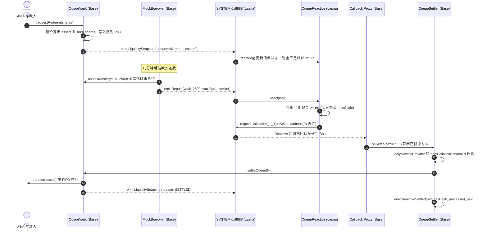
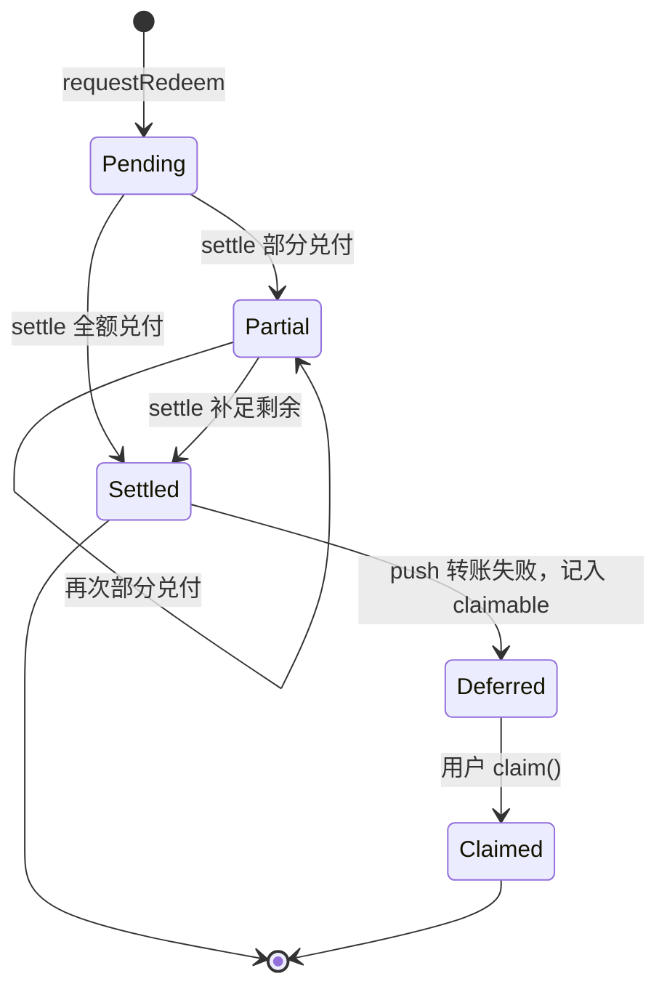
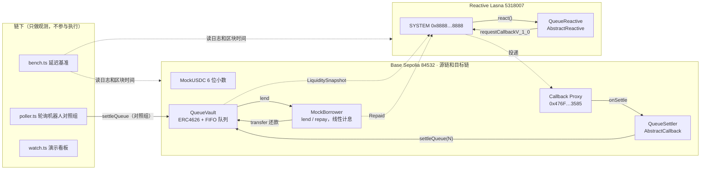
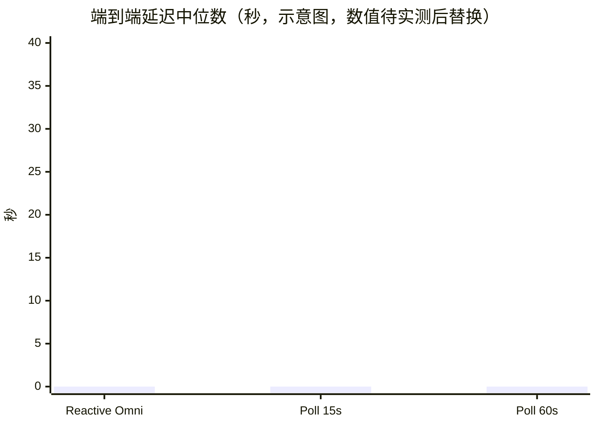
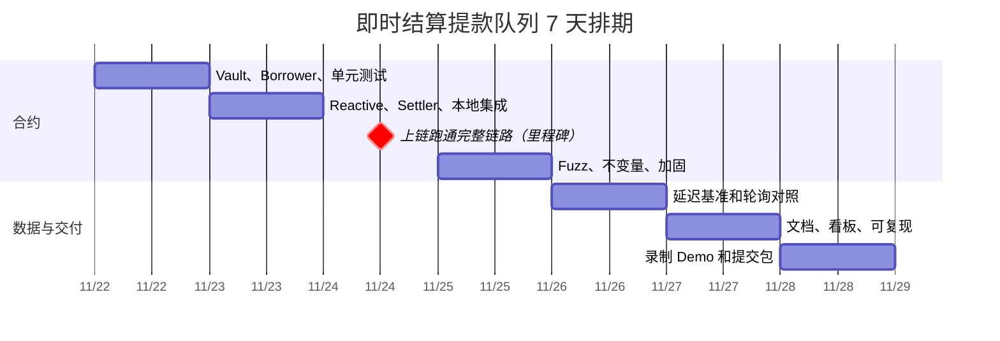

# ⚡ 即时结算提款队列（Instant-Settle Withdrawal Queue）产品与技术方案

> 赛事：Reactive Omni Buildathon · **赛道 1 Every Second Counts**
> 网络：Base Sepolia（84532，源链和目标链）↔ Reactive Lasna（5318007）
> 版本：v0.1（2026-11-21）· 状态：方案评审稿，还没开始写代码
> 标记约定：🔎 **待核实** = 部署或实测前必须再确认的事实，本文不替它编数字

---

## 0. TL;DR（先看这一屏）

| 问题 | 结论 |
|---|---|
| 做什么 | 一个 ERC4626 金库：大部分资金借出生息，现金不够时提款进入 FIFO 队列。**资金一回流，Reactive 就在秒级自动兑付**，替代“机器人定时轮询” |
| 为什么必须用 Reactive | 还款方用 **ERC-20 `transfer` 直接把钱打回金库**，金库自己的代码不会被执行，没法在同一笔交易里结算。必须有一个**链外看得见、链上能执行**的角色，Reactive 就是这个角色，而且不需要服务器和私钥 |
| 为什么需要 Omni 的 1 秒出块 | 兑付延迟越短，金库就敢留越少的现金缓冲，资金利用率越高。旧版大约 7 秒出块，加上轮询机器人 30–60 秒的间隔，都撑不起“秒级退出”这个承诺 |
| 六个关键取舍 | ① **锁价 + 申请时立即销毁份额** ② **虚拟份额（offset=6）+ 部署时种子存款**，舍入一律有利于金库 ③ **head/tail + mapping 的 FIFO，允许队首部分兑付**，N=10 初值，用 gas 实测校准，余量靠事件自续 ④ **settleQueue 不设权限，任何人都能调**，回调是快通道，人工调用是兜底，靠 nonReentrant 和 CEI 保证幂等 ⑤ **MockBorrower** 按时间戳线性计息，还款直接 transfer 回金库 ⑥ **回调次数上限 + 自动退订 + 熔断 + debt 巡检脚本** |
| 第几天必须跑通链路 | **D3（11/24）** 链上必须查到完整的三笔交易 |
| 演示时间 | D7（11/28）录好视频，11/29 Demo Day，12/5 前在 DoraHacks 提交 |

---

## 1. 一句话概述与核心价值

**一句话**：让“生息金库的排队提款”在资金回流后几秒内自动到账，不用跑机器人，不用托管私钥，结算顺序由链上规则保证公平。

| 核心价值 | 面向谁 | 说明 |
|---|---|---|
| 🏃 秒级退出 | 存款人 | 还款或新存款一到账，排队的请求按 FIFO 顺序自动兑付，目标是端到端几秒（🔎 以实测为准） |
| 💰 更高资金利用率 | 金库管理人 | 结算越快，需要的现金缓冲越少。假设缓冲从 20% 降到 5%、APR 为 8%，相当于多出 **1.2% 的年化收益**（15% × 8%，仅为示意） |
| 🧹 零运维 | 金库管理人 | 不需要 keeper 服务器、不用托管热钱包私钥、没有 cron。触发逻辑写在合约里，开源可审计 |
| ⚖️ 可验证的公平 | 所有人 | FIFO 顺序、价格和兑付上限都写在合约里，排队期间的现金不会被插队的即时提款拿走 |

> 🧑‍💻 **Java/TS 类比**：ERC4626 金库相当于“基金申购赎回系统”，份额（shares）就是基金份额。提款队列相当于一个 `ArrayDeque<RedeemRequest>`。Reactive 相当于托管在链上的 **Kafka consumer + webhook**：订阅事件（topic），在 `react()` 里做判断，然后回调目标链上的一个函数。

---

## 2. 用户画像与痛点

### 2.1 用户画像

| 角色 | 典型诉求 | 现在的痛点 |
|---|---|---|
| 👩 存款人 Alice | 平时赚利息，要用钱时尽快取出 | 现金不够时只能“明天再来试”，或者等管理人手动处理 |
| 🧑‍💼 金库管理人 Bob | 尽量多借出资金赚利息，同时不让用户提款卡住 | 为了应对提款只好多留现金，收益被拉低；还要自己维护 keeper 机器人 |
| 🏦 集成方（其他协议持有金库份额） | 退出路径可预期 | 退出时间不确定，风控只能按最坏情况估 |

### 2.2 与轮询机器人方案对比

| 维度 | 🤖 定时轮询机器人（cron + EOA） | ⚡ 事件驱动 WS 机器人（自建） | 🔁 Reactive Omni（本项目） |
|---|---|---|---|
| 触发方式 | 每 P 秒查一次 `queueCash()` | 订阅 WebSocket 日志 | 订阅链上事件，系统合约调用 `react()` |
| 兑付延迟 | 平均约 P/2 + 上链时间（P=60s 时约 30s+） | 亚秒到秒级，取决于 RPC | 约 2 个 Reactive 区块 + 投递时间（🔎 待实测，目标 < 5s） |
| 基础设施 | 服务器、进程守护、告警 | 服务器、WS 断线重连、告警 | **无**，只有链上合约 |
| 私钥风险 | 热钱包私钥放在服务器上 | 同左 | **无私钥**，回调由 Reactive 网络签名，经 Callback Proxy 鉴权 |
| 单点故障 | 机器挂了，队列就卡住 | 同左，WS 断线还可能漏事件 | Reactive 网络执行，另有**任何人可调用**的兜底入口 |
| 逻辑透明度 | 链下代码，不可验证 | 同左 | 合约开源，在 Reactscan 上可查每次 react |
| 成本 | 服务器费 + gas | 服务器费 + gas | 每次 react 消耗 lREACT，每次回调消耗目标链 ETH |

> 🎯 **诚实结论**：一个写得很好的 WS 机器人在延迟上可以和 Reactive 打平。Reactive 胜在**没有服务器、没有私钥、逻辑可验证**，而 Omni 的约 1 秒出块让它在延迟上**第一次**能和机器人比。我们的数据会同时和“轮询机器人”与“WS 机器人”做对比，不只挑最弱的对手。

---

## 3. MVP 功能范围（Must / Should / Won't）

### ✅ Must（D6 前全部完成，缺一项就不能演示）

| # | 功能 | 验收标准 |
|---|---|---|
| M1 | `QueueVault`：OZ ERC4626 + MockUSDC（6 位小数），`_decimalsOffset()=6`，部署脚本里做种子存款 | `forge test` 通过 deposit/mint/withdraw/redeem 的舍入测试 |
| M2 | 即时提款受 `instantCash()` 限制，不能挪用排队资金 | 队列非空时 `maxWithdraw` 只能用超出队列负债的现金 |
| M3 | `requestRedeem`：锁价、立即销毁份额、进入 FIFO 队列 | 请求前后每份额价格（PPS）不下降 |
| M4 | `settleQueue(maxCount)`：任何人可调用，FIFO，队首可部分兑付，push 转账失败时转成 claimable，没有工作可做时不 revert | 幂等性测试和不变量测试通过 |
| M5 | `MockBorrower`：`lend` / `repay`，按时间戳线性计息，还款直接 `transfer` 回金库并发出 `Repaid` 事件 | 还款前后 PPS 不变 |
| M6 | `QueueReactive`（Lasna）：订阅金库快照和借款人还款两类事件，在 `react()` 里做判断，有回调次数上限并自动退订 | 本地 MockSystem 测试通过，链上查得到 react |
| M7 | `QueueSettler`（Base Sepolia）：继承 `AbstractCallback`，同时加 `onlyServiceProvider` 和 `onlyCallbackSender` | 伪造调用一律 revert |
| M8 | 部署脚本，一条命令跑完整条链路 | 新人照 README 操作，30 分钟内能复现 |
| M9 | 延迟基准：Reactive 至少 30 个样本，轮询机器人至少一档间隔 30 个样本 | 输出中位数、P95 表和 CSV |
| M10 | `status.sh`：打印 balance、reserves、debt 和剩余回调次数 | 一条命令能看出“合约是不是活着” |
| M11 | README、3 分钟演示视频、提交包 | 符合 DoraHacks 提交项 |

### 🟡 Should（时间够再做，按优先级排）

| # | 功能 | 价值 |
|---|---|---|
| S1 | `watch.ts`：终端里实时显示三段交易和耗时 | 演示观感大幅提升 |
| S2 | WS 事件驱动机器人作为第二个对照组 | 对比更诚实，Integration 加分 |
| S3 | Reactive 侧“在途去重”（同一个 head 30 秒内不重复请求回调） | 省回调费 |
| S4 | 熔断：60 秒内 react 次数超过阈值就自动退订 | 防止被刷事件耗尽预算 |
| S5 | `redeemOrQueue(shares)`：现金够就即时提款，不够就自动排队 | 用户体验 |
| S6 | 在 Unichain Sepolia 再部署一套，做延迟对比 | 赛道 1 允许两条链都用 |

### ❌ Won't（这次明确不做，演示时主动说明）

| 不做 | 原因 |
|---|---|
| 完整的 ERC-7540 合规（operator、ERC-165、claim 两段式） | 本项目“自动 push 兑付”本来就有意偏离 7540 的 claim 模式，下面有说明 |
| 取消排队请求 | 取消后用什么价格重铸份额，会引入新的套利面 |
| 坏账、损失分摊（按 min(申请价, 兑付价) 结算） | Mock 借款人不会违约，放到路线图 |
| 对接真实借贷协议（Aave、Morpho） | 测试网流动性和时间都不允许 |
| Web 前端 | 用终端加区块浏览器演示 |
| 主网部署、合约可升级、keeper 激励 | 超出范围 |

---

## 4. 用户流程

### 4.1 四条主流程

| 流程 | 触发者 | 链上动作 | 结果 |
|---|---|---|---|
| A 存款 | 用户 | `deposit(assets, receiver)` | 获得份额；如果队列活跃，就发出快照事件，可能触发结算 |
| B 即时提款 | 用户 | `redeem` / `withdraw`（受 `maxRedeem` / `maxWithdraw` 限制） | 当场到账 |
| C 排队提款 + 自动兑付 | 用户 → 借款人或新存款人 → Reactive | `requestRedeem` → 资金回流 → `react()` → `onSettle` → `settleQueue` | 秒级自动到账 ⭐ |
| D 兜底手动结算 | 任何人 | `settleQueue(maxCount)` | 和流程 C 结果相同，用于 Reactive 不可用的情况 |

### 4.2 核心时序（流程 C）



### 4.3 单个请求的生命周期



---

## 5. 系统架构

### 5.1 架构图



### 5.2 三条链各部署什么

| 链 | chainId | 部署的合约 | 资金 | 地址来源 |
|---|---|---|---|---|
| **Base Sepolia** | 84532 | MockUSDC、QueueVault、MockBorrower、QueueSettler | ETH：部署 gas + Settler 回调费（约 0.02 ETH） | Callback Proxy `0x476F44b11F5C942c58f4c8E3d0300E5710743585`（2026-11-21 已对照 [官方页](https://dev.reactive.network/origins-and-destinations) 核实） |
| **Reactive Lasna** | 5318007 | QueueReactive | lREACT：约 3（用于 react 计费） | SYSTEM `0x8888888888888888888888888888888888888888`（omni 库常量，已核实） |
| Ethereum Sepolia | 11155111 | **不部署合约**，只用来换 lREACT | Sepolia ETH 转给 faucet `0x9b9BB25f1A81078C544C829c5EB7822d747Cf434` | 速查表 11/08 核对；🔎 部署前再核实一次 |
| （S6 可选）Unichain Sepolia | 1301 | 同 Base 的一套 | ETH | Proxy `0x775c9B990ADe401060B78D0e98684eEf8d2466C1`（2026-11-21 已核实） |

> 🔎 Base Sepolia 上也有 lREACT faucet（速查表记录为 `0x2afaFD298b23b62760711756088F75B7409f5967`），使用前请再核实一次。

### 5.3 为什么金库不在 `deposit` / `repay` 里直接结算？（评委一定会问）

| 理由 | 说明 |
|---|---|
| ① 资金回流不经过金库代码 | 还款就是一笔 ERC-20 `transfer`，ERC-20 没有接收回调（ETH 有 `receive`，ERC-20 没有）。真实场景里钱通常先回到借贷市场（Aave / Morpho），金库根本不知道。**MVP 特意保留这一点**：借款人直接 `transfer`，金库代码一行都没执行 |
| ② gas 外部化 | 如果在 `deposit` 里顺手兑付 N 笔，一个 10 USDC 的存款人可能要为别人的 50 笔转账付 gas。对集成方来说 deposit 的 gas 也不可预测 |
| ③ 失败耦合 | 兑付失败会导致 deposit 一起 revert，等于 deposit 被 DoS |
| ④ 可扩展到跨链 | 资金可能在另一条链回流（例如在 Arbitrum 上清算还款），Reactive 天然支持跨链监听，内联写法做不到 |

> 🧑‍💻 **Java 类比**：这就是“在 Controller 里同步调用下游”和“发事件交给消费者异步处理”的区别。ERC-20 `transfer` 相当于一个不触发任何 listener 的 `map.put()`，所以只能靠外部观察者。

---

## 6. 合约设计

> 依赖：`reactive-lib-omni`（`@reactive/src/...`）、OpenZeppelin Contracts v5.x（ERC4626、Ownable、ReentrancyGuard、SafeERC20；🔎 版本号在 `forge install` 后锁定）、Solidity `^0.8.29`、`evm_version = cancun`。
> 建议目录：新建 `queue-vault/` Foundry 工程，`src/`、`test/`、`script/`、`bench/`（TypeScript + viem）都放在里面。

### 6.1 事件契约（先定事件，再写合约）

> 💡 react() 读不到 Base 上的状态，所以**事件必须携带判断所需的全部数据**。这就是 Event-Carried State Transfer 模式：Kafka 消息里直接带完整快照，消费者不需要回源查库。

| 事件 | 发出方 | indexed（topic） | data 字段 | 订阅过滤 |
|---|---|---|---|---|
| `LiquiditySnapshot` | QueueVault | `bool queueActive`（topic1），`uint8 reason`（topic2） | `seq, queueCash, headId, headRemaining, totalQueued, totalClaimable, pendingCount, timestamp` | topic1 = 1，只在队列活跃或刚被清空时投递 |
| `Repaid` | MockBorrower | `address vault`（topic1） | `amount, vaultBalanceAfter, timestamp` | topic1 = 本金库地址 |
| `SettleRequested` | QueueReactive（Lasna） | `uint256 originTxHash` | `source, seq, cashForQueue, headRemaining, maxCount` | 不订阅，用于测延迟 |
| `ReactiveSettled` | QueueSettler（Base） | `uint256 originTxHash` | `processed, paid, newHead, timestamp` | 不订阅，用于测延迟 |

- `queueActive = pendingCount > 0 || 本次操作恰好清空了队列`。队列空闲时的存款不会把事件投递到 Lasna，**不产生 react 费用**；队列清空的那一刻仍然投递一次，让 Reactive 侧的镜像状态归零。
- `reason`：1=DEPOSIT，2=REQUEST，3=SETTLED。只有这三处会发出快照：即时提款和 lend 只动“超出队列负债”的现金，不影响结算判断。
- topic0 部署时用 `cast keccak "LiquiditySnapshot(bool,uint8,uint256,uint256,uint256,uint256,uint256,uint256,uint256,uint64)"` 计算，**不在文档里手写哈希**。

### 6.2 QueueVault（Base Sepolia）

`contract QueueVault is ERC4626, Ownable, ReentrancyGuard`

**状态变量**

| 变量 | 类型 | 说明 |
|---|---|---|
| `borrower` | `IMockBorrower` | 只能设置一次 |
| `requests` | `mapping(uint256 => RedeemRequest)` | 队列存储，相当于 `HashMap<Long, Request>` |
| `head` | `uint256` | 第一个未结清请求的 id，只增不减 |
| `tail` | `uint256` | 下一个要分配的 id；`[head, tail)` 就是队列 |
| `totalQueuedAssets` | `uint256` | Σ 所有请求的 `assetsRemaining`（队列负债） |
| `claimable` | `mapping(address => uint256)` | push 失败后转成 pull 的待领余额 |
| `totalClaimable` | `uint256` | Σ claimable |
| `snapshotSeq` | `uint256` | 快照单调序号，用于去重和延迟关联 |
| `minRequestAssets` | `uint256` | 最小排队金额，防刷请求（演示取 1 USDC，生产可以更高） |
| `bufferBps` | `uint16` | lend 后至少保留的现金比例（演示取 500，即 5%） |
| `MAX_SETTLE_PER_CALL` | `uint256 constant` | 单次结算上限的硬顶 50，防止无界循环 |

```solidity
struct RedeemRequest {
    address owner;
    address receiver;
    uint128 assetsTotal;      // 锁定的应付资产
    uint128 assetsRemaining;  // 剩余待付
    uint64  requestedAt;      // block.timestamp（Base 200ms 出块，只用时间戳）
    uint64  settledAt;
}
```

**函数签名**

| 函数 | 修饰符 | 说明 |
|---|---|---|
| `constructor(IERC20 asset_, uint256 minRequestAssets_, uint16 bufferBps_)` | — | `ERC4626(asset_)`、`ERC20("Queue Vault USDC","qvUSDC")`、`Ownable(msg.sender)`；`head = tail = 1` |
| `setBorrower(address b)` | `onlyOwner` | 只能设置一次 |
| `totalAssets() view override` | — | `cash + borrower.owed() - totalQueuedAssets - totalClaimable`，用饱和减法 |
| `_decimalsOffset() internal pure override` | — | `return 6;` |
| `maxWithdraw(address) / maxRedeem(address) view override` | — | 再和 `instantCash()` 取 min |
| `_deposit(...) internal override` | — | `super._deposit` 后调用 `_snapshot(DEPOSIT)` |
| `requestRedeem(uint256 shares, address receiver, address owner) returns (uint256 id)` | `nonReentrant` | 锁价、burn 份额、入队、发快照 |
| `settleQueue(uint256 maxCount) returns (uint256 processed, uint256 paid)` | `nonReentrant`，**不设权限** | FIFO 结算；没有工作可做时直接 return，不 revert |
| `claim() returns (uint256)` | `nonReentrant` | 领取 push 失败后的余额 |
| `lend(uint256 assets)` | `onlyOwner nonReentrant` | 只能动 `instantCash` 里超出缓冲的部分 |
| `queueCash() / instantCash() / pendingCount() / getRequest(id)` | `view` | 给 react、脚本和测试用 |

**事件**

```solidity
event RedeemRequested(uint256 indexed id, address indexed owner, address indexed receiver, uint256 shares, uint256 assets, uint64 requestedAt);
event RedeemSettled(uint256 indexed id, address indexed receiver, uint256 paid, uint256 remaining, bool done);
event PayoutDeferred(uint256 indexed id, address indexed receiver, uint256 amount);
event SettleSkipped(uint256 head, uint256 queueCash);   // 没有工作可做，属于正常情况
event Lent(uint256 assets, uint256 cashAfter);
event LiquiditySnapshot(bool indexed queueActive, uint8 indexed reason, uint256 seq, uint256 queueCash,
    uint256 headId, uint256 headRemaining, uint256 totalQueued, uint256 totalClaimable, uint256 pendingCount, uint64 timestamp);
```

**三种现金口径**（整个设计的核心）

| 口径 | 公式 | 谁能用 |
|---|---|---|
| `cash` | `asset.balanceOf(this)` | — |
| `queueCash()` | `cash - totalClaimable` | `settleQueue` 兑付队列 |
| `instantCash()` | `max(0, cash - totalClaimable - totalQueuedAssets)` | 即时提款、`lend` |

> ⚖️ 排队请求先占用现金，即时提款只能用“队列全部付清后还剩的钱”。所以即使还款到账到回调落地之间有几秒空档，也不会被人插队。

**关键伪代码**

```solidity
function requestRedeem(uint256 shares, address receiver, address owner) external nonReentrant returns (uint256 id) {
    if (receiver == address(0)) revert ZeroAddress();
    if (msg.sender != owner) _spendAllowance(owner, msg.sender, shares);
    uint256 assets = previewRedeem(shares);                 // Floor：有利于金库
    if (assets < minRequestAssets) revert RequestTooSmall();
    _burn(owner, shares);                                   // 立即销毁，PPS 不变
    id = tail++;
    requests[id] = RedeemRequest(owner, receiver, uint128(assets), uint128(assets), uint64(block.timestamp), 0);
    totalQueuedAssets += assets;
    emit RedeemRequested(id, owner, receiver, shares, assets, uint64(block.timestamp));
    _snapshot(REASON_REQUEST, false);
}

function settleQueue(uint256 maxCount) external nonReentrant returns (uint256 processed, uint256 paid) {
    if (maxCount > MAX_SETTLE_PER_CALL) maxCount = MAX_SETTLE_PER_CALL;
    bool wasActive = head < tail;
    uint256 avail = queueCash();
    uint256 id = head;
    while (processed < maxCount && id < tail && avail > 0) {
        uint256 rid = id;
        RedeemRequest storage r = requests[rid];
        uint256 pay = min(r.assetsRemaining, avail);
        // —— Effects：先改完所有状态 ——
        r.assetsRemaining -= uint128(pay);
        totalQueuedAssets -= pay;
        avail -= pay; paid += pay; processed++;
        bool done = (r.assetsRemaining == 0);
        if (done) { r.settledAt = uint64(block.timestamp); id++; }
        head = id;                                          // CEI：转账前就推进指针
        // —— Interactions ——
        _payout(rid, r.receiver, pay);                      // 失败转成 claimable，不 revert
        emit RedeemSettled(rid, r.receiver, pay, r.assetsRemaining, done);
        if (!done) break;                                   // 现金已经用完
    }
    if (processed == 0) { emit SettleSkipped(head, queueCash()); return (0, 0); }  // 幂等：不 revert
    _snapshot(REASON_SETTLED, wasActive);                   // 队列刚被清空时也要投递一次
}

function _payout(uint256 id, address to, uint256 amt) internal {
    (bool ok, bytes memory ret) = address(asset()).call(abi.encodeCall(IERC20.transfer, (to, amt)));
    if (!ok || (ret.length != 0 && !abi.decode(ret, (bool)))) {
        claimable[to] += amt; totalClaimable += amt;        // 一个坏的接收者不会卡住整条队列
        emit PayoutDeferred(id, to, amt);
    }
}

function _snapshot(uint8 reason, bool wasActive) internal {
    uint256 pending = tail - head;
    bool active = pending > 0 || wasActive;
    RedeemRequest storage h = requests[head];
    emit LiquiditySnapshot(active, reason, ++snapshotSeq, queueCash(), head,
        pending > 0 ? h.assetsRemaining : 0, totalQueuedAssets, totalClaimable, pending, uint64(block.timestamp));
}

function lend(uint256 assets) external onlyOwner nonReentrant {
    uint256 floor = totalAssets() * bufferBps / 10_000;
    if (instantCash() < assets + floor) revert ExceedsLendable();  // 队列非空时 instantCash≈0，自动禁止放贷
    SafeERC20.safeTransfer(IERC20(asset()), address(borrower), assets);
    borrower.onLend(assets);
    emit Lent(assets, IERC20(asset()).balanceOf(address(this)));
}
```

### 6.3 MockBorrower（Base Sepolia，测试网专用）

| 项 | 内容 |
|---|---|
| 状态 | `vault`（immutable）、`operator`、`principal`、`accruedInterest`、`lastAccrual`（uint64 时间戳）、`aprBps`（默认 800） |
| `owed() view` | `principal + accruedInterest + principal * aprBps * (now - lastAccrual) / (10_000 * 365 days)` |
| `onLend(uint256 amt)` | `onlyVault`：先 `_accrue()`，再 `principal += amt` |
| `repay(uint256 amt)` | `onlyOperator`：`_accrue()`，要求 `amt <= owed()`；先还利息再还本金；利息部分用 `MockUSDC.mint` 补足（只在测试网这样做）；`asset.transfer(vault, amt)`；`emit Repaid(vault, amt, asset.balanceOf(vault), now)` |
| 事件 | `event Repaid(address indexed vault, uint256 amount, uint256 vaultBalanceAfter, uint64 timestamp)` |

> 📐 因为 `totalAssets = cash + owed - 负债`，还款让 cash 增加 x、owed 减少 x，**PPS 不变**。利息随时间平滑计入 PPS，不会在还款那一刻跳涨，也就不会出现“还款前存入、还款后取出”的收益狙击（yield sniping）。

### 6.4 QueueReactive（Lasna）

`contract QueueReactive is AbstractReactive`

| 状态变量 | 说明 |
|---|---|
| `OWNER`、`CHAIN_ID`（84532）、`VAULT`、`BORROWER`（immutable） | 构造时写定 |
| `SNAPSHOT_TOPIC0`、`REPAID_TOPIC0`（immutable，构造参数传入） | 由 `cast keccak` 计算 |
| `settler` | 目标链回调合约，部署后通过 `setSettler` 设置 |
| `maxPerCallback`（N）、`callbackGasLimit`、`minSettleAssets` | 可调参数；gasLimit 不能低于 100k，否则 revert |
| `remainingCallbacks` | 回调预算，归零时自动退订 |
| `subscribed`、`paused` | 订阅状态 |
| `mirror` | `struct { seq; headId; headRemaining; totalClaimable; pendingCount; }`，**Base 队列状态在 Lasna 上的镜像** |
| `inflightHead`、`inflightUntil`（S3） | 在途去重 |
| `reactCount`、`callbackCount` | 统计 |

| 函数 | 修饰符 | 说明 |
|---|---|---|
| `constructor(vault, borrower, snapTopic0, repaidTopic0, n, gasLimit, minSettle, budget) payable` | — | 调用 `_subscribeAll()` |
| `react(LogRecord calldata log_)` | `onlySystem` | 主逻辑，**绝不 revert** |
| `setSettler(address)` | `onlyOwner` | — |
| `setParams(n, gasLimit, minSettle)` | `onlyOwner` | gasLimit 低于 100_000 时 revert |
| `topUp(uint256 budget) payable` | `onlyOwner` | 补预算，先 `_coverDebt()` 再重新订阅 |
| `pause() / resume()` | `onlyOwner` | 退订或重新订阅（参数必须和订阅时完全一致） |
| `coverDebt()` | — | 对外包装基类的 `_coverDebt()` |

```solidity
// 伪代码：表达逻辑，不保证能直接编译（例如元组解构的写法需要改成先声明变量）
function react(LogRecord calldata log_) external onlySystem {
    reactCount++;
    if (log_.chainId != CHAIN_ID || paused) return;
    uint256 cashForQueue; uint8 source; uint256 seq;

    if (log_.contractAddress == VAULT && log_.topic0 == SNAPSHOT_TOPIC0) {
        if (log_.data.length != 8 * 32) return;                  // 防御：数据长度不对时 abi.decode 会 revert
        (seq, uint256 queueCash, uint256 headId, uint256 headRem, , uint256 claimable_, uint256 pending, )
            = abi.decode(log_.data, (uint256,uint256,uint256,uint256,uint256,uint256,uint256,uint64));
        if (seq <= mirror.seq) return;                            // 过期或重复的快照
        mirror = Mirror(seq, headId, headRem, claimable_, pending);
        cashForQueue = queueCash; source = SRC_SNAPSHOT;
    } else if (log_.contractAddress == BORROWER && log_.topic0 == REPAID_TOPIC0) {
        if (log_.data.length != 3 * 32) return;
        (, uint256 balAfter, ) = abi.decode(log_.data, (uint256, uint256, uint64));
        cashForQueue = balAfter > mirror.totalClaimable ? balAfter - mirror.totalClaimable : 0;
        source = SRC_REPAID;
    } else return;

    if (mirror.pendingCount == 0) return;                         // 队列为空
    uint256 threshold = min(mirror.headRemaining, minSettleAssets);
    if (cashForQueue < threshold) { emit Skipped(log_.txHash, 1); return; }
    if (remainingCallbacks == 0 || settler == address(0)) return;
    // （S3）if (inflightHead == mirror.headId && block.timestamp < inflightUntil) return;

    if (--remainingCallbacks == 0) _unsubscribeAll();
    bytes memory payload = abi.encodeWithSignature(
        "onSettle(address,uint8,uint256,uint256,uint256)",
        address(0), source, seq, log_.txHash, maxPerCallback   // 首参 address(0) 占位，由网络替换成本合约地址
    );
    emit SettleRequested(log_.txHash, source, seq, cashForQueue, mirror.headRemaining, maxPerCallback);
    SYSTEM.requestCallbackV_1_0(ISystemContract.CallbackConfiguration_V_1_0({
        chainId: CHAIN_ID, recipient: settler, gasLimit: callbackGasLimit, payload: payload
    }));
}
```

> 🧠 **react() 承担的实际工作**（Integration 评分点）：融合两个事件源的数据（金库快照 + 第三方借款人的还款）、维护跨链镜像状态、过滤过期快照、判断阈值、管理预算和熔断、选择 N。**真正的业务决策发生在 Reactive 侧，金库只负责陈述事实。**

订阅（构造函数中）：

```solidity
SYSTEM.subscribe(CHAIN_ID, VAULT,    SNAPSHOT_TOPIC0, 1,                          REACTIVE_IGNORE, REACTIVE_IGNORE); // 只收 queueActive=true
SYSTEM.subscribe(CHAIN_ID, BORROWER, REPAID_TOPIC0,   uint256(uint160(VAULT)),    REACTIVE_IGNORE, REACTIVE_IGNORE); // 只收还给本金库的
```

### 6.5 QueueSettler（Base Sepolia）

`contract QueueSettler is AbstractCallback`

| 项 | 内容 |
|---|---|
| 状态 | `VAULT`（immutable）；继承得到 `_CALLBACK_SENDER`（immutable，等于 QueueReactive 地址，**填错只能重新部署**）和 `_SERVICE_PROVIDER`（等于 Proxy） |
| 构造 | `constructor(IPayable proxy_, address reactive_, IQueueVault vault_) payable AbstractCallback(proxy_, reactive_)` |
| 回调 | `onSettle(address rvm, uint8 source, uint256 seq, uint256 originTxHash, uint256 maxCount) external onlyServiceProvider onlyCallbackSender(rvm)` |
| 事件 | `event ReactiveSettled(uint256 indexed originTxHash, uint8 source, uint256 seq, uint256 processed, uint256 paid, uint256 newHead, uint64 timestamp)` |
| 运维 | `coverDebt()` 对外包装 |

```solidity
function onSettle(address rvm, uint8 source, uint256 seq, uint256 originTxHash, uint256 maxCount)
    external onlyServiceProvider onlyCallbackSender(rvm)
{
    (uint256 processed, uint256 paid) = VAULT.settleQueue(maxCount);  // 没有工作时返回 (0,0)，不 revert
    emit ReactiveSettled(originTxHash, source, seq, processed, paid, VAULT.head(), uint64(block.timestamp));
}
```

> 🔐 两道校验就像 webhook 的“来源 IP 白名单 + 签名校验”：`onlyServiceProvider` 检查 `msg.sender == Proxy`，`onlyCallbackSender(rvm)` 检查 Proxy 注入的首参是不是我们自己的 Reactive 合约。

> ❓ **为什么 Settler 要和金库分开？** ① 回调手续费（ETH）和用户资产（USDC）隔离；② 换 Reactive 合约时只需要重新部署 Settler，金库不动；③ 金库保持为一个干净的 ERC4626，方便审计。代价是多一次外部调用，大约 2–3k gas。

---

## 7. 关键设计取舍

### 7.1 排队期间份额价格变化：用哪个价格？份额怎么处理？

**价格口径**

| 方案 | 做法 | 优点 | 缺点 |
|---|---|---|---|
| **A 锁定申请价** ⭐ | 申请时 `assets = previewRedeem(shares)`，之后固定不变 | 负债确定，react 能精确判断“够不够付队首”；不变量简单 | 排队期间不再享受收益（但用户本来就已经选择退出）；发生坏账时排队者能躲过损失 |
| B 兑付时价格 | 兑付时按当时 PPS 换算 | 排队者和留下的人风险收益一致 | 队首金额一直在变，事件里的数据过时，react 判断不准；份额必须托管 |
| C min(申请价, 兑付价) | Lido 提款队列的思路 | 防止“预见坏账就抢先排队”的逆向选择 | 实现复杂；Mock 借款人没有损失，演示不出区别 |

**份额处理**

| 方案 | 做法 | 评价 |
|---|---|---|
| **立即销毁** ⭐ | 申请时直接 `_burn` | 配合方案 A：`totalSupply` 和 `totalAssets` 同步减少，PPS 不下降（下面有证明），实现最简单 |
| 托管 | 转给金库，兑付时再 burn | 方案 B 必须这样做；托管的份额还在 `totalSupply` 里，要特别处理 |
| 锁定 | 份额留在用户名下，但禁止转账 | 要改 ERC20 的 `_update`，和 DeFi 集成冲突 |

**✅ 推荐：A + 立即销毁**；方案 C 作为路线图（加入损失上报以后再做）。

📐 **PPS 不下降的证明**：设原来的资产为 A、份额为 S，申请赎回 s 份，`a = floor(s·A/S) ≤ s·A/S`。新的 PPS = (A−a)/(S−s) ≥ (A − s·A/S)/(S−s) = A/S ∎（虚拟份额只会让不等式更宽松）

### 7.2 通胀攻击防护与舍入方向

**攻击回顾**：攻击者先存 1 wei 拿到 1 份，再直接 `transfer` 大量资产“捐赠”给金库，把 PPS 抬到极高。之后受害者存款算份额时向下取整成 0，钱就被攻击者吞了。

| 方案 | 原理 | 优点 | 缺点 |
|---|---|---|---|
| **虚拟份额 `_decimalsOffset()`** ⭐ | OZ v5 内置：计算时分子分母都加上虚拟份额和虚拟资产 | 不需要额外流程；offset=6 时攻击者自身的损失约为受害者损失的 10⁶ 倍，攻击无利可图 | 极少量价值被虚拟份额“吃掉”（可忽略） |
| **部署时种子存款（dead shares）** ⭐ | 部署脚本存入 1 USDC，份额 mint 给 `0x…dEaD` | 让第一次存款不在空金库上发生 | 需要部署人付出 1 USDC 测试币 |
| 内部记账（不用 balanceOf） | 自己维护 idle，捐赠不计入资产 | 从根上免疫捐赠 | 每条资金路径都要同步记账，容易出错；我们的还款就是外部 transfer，正好需要 balanceOf |
| 最小存款额 | 小额存款直接 revert | 简单 | 只能减缓，挡不住 |

**✅ 推荐：offset=6 + 种子存款**，两层防护，都是现成方案。内部记账和本项目“还款直接 transfer”的模型冲突，不采用。

**舍入方向**（原则：**永远有利于金库，也就是有利于留下来的人**）

| 入口 | 计算 | 舍入 | 理由 |
|---|---|---|---|
| `deposit(assets)` | 发给用户的 shares | ⬇️ Floor | 少发份额 |
| `mint(shares)` | 向用户收的 assets | ⬆️ Ceil | 多收资产 |
| `withdraw(assets)` | 销毁的 shares | ⬆️ Ceil | 多烧份额 |
| `redeem(shares)` | 付给用户的 assets | ⬇️ Floor | 少付资产 |
| `requestRedeem(shares)` | 锁定的 assets | ⬇️ Floor（复用 `previewRedeem`） | 和 redeem 一致 |
| `maxRedeem` 换算 instantCash | `convertToShares(instantCash)` | ⬇️ Floor | 不能让 maxRedeem 超出现金 |
| 借款利息 `owed()` | 线性利息 | ⬇️ Floor | 不高估资产 |

> 🧑‍💻 **Java 类比**：就像银行系统里 `BigDecimal.setScale(2, RoundingMode.DOWN)` 统一用于“付给客户”的方向，`UP` 统一用于“向客户收取”的方向。

### 7.3 队列数据结构与单次上限 N

**数据结构**

| 方案 | 入队 / 出队 | 部分兑付 | 评价 |
|---|---|---|---|
| **head/tail 指针 + mapping** ⭐ | O(1) / O(1) | 支持（修改队首的 remaining） | 和 `ArrayDeque` 的思路一样；历史记录可查；不用搬移数据 |
| 动态数组 + 删除首元素 | O(1) / O(n) | 支持 | 删除首元素要整体搬移，gas 爆炸 ❌ |
| 链表 | O(1) / O(1) | 支持 | 能做“取消请求”，但我们不做取消，属于过度设计 |
| 按用户聚合的 mapping | — | — | 失去 FIFO 顺序 ❌ |

**队首现金不够时怎么办？**

| 方案 | 行为 | 评价 |
|---|---|---|
| 全有或全无 | 现金 < 队首金额就停 | 一笔大额请求会堵住整个队列（队头阻塞） |
| 跳过大额，先付后面的小额 | 不再是 FIFO | 不公平 ❌ |
| **部分兑付队首** ⭐ | 有多少付多少，队首的 remaining 相应减少 | 现金利用率最高，严格 FIFO，不会饿死任何请求 |

为了不让 1 wei 的回流也触发回调，react 的触发门槛是 `min(队首剩余, minSettleAssets)`。

**N 的取值依据**（D2 用 `forge test --gas-report` 实测校准）

```
callbackGasLimit ≥ (Settler 固定开销 + settleQueue 固定开销 + N × 单笔兑付 gas) × 1.3 安全系数 + Proxy 记账开销
```

| 参数 | 初值 | 依据 |
|---|---|---|
| 单笔兑付 gas | 约 60–80k（🔎 待实测） | 读写 2 个存储槽 + ERC-20 transfer（冷账户）+ 一个事件 |
| **N（maxPerCallback）** | **10** | 演示场景一次回流通常够付 1–5 笔；10 笔留了余量 |
| callbackGasLimit | 1,500,000（🔎 待实测后调整） | 大于 100k 下限，远低于 Base 的区块 gas 上限 |
| `MAX_SETTLE_PER_CALL` | 50 | 合约硬顶，防止人工兜底调用时传入一个巨大的 maxCount |

**剩余请求怎么在下一次继续？事件自续** 🔁

1. 一次结算付满 N 笔后，如果还有现金、队列也不为空，就会发出 `LiquiditySnapshot(reason=SETTLED, queueActive=true)`
2. react 收到后发现“现金 ≥ 门槛”，再请求一次回调
3. 每一轮 head 都严格前进，所以循环一定会终止：要么现金用完，要么队列清空，要么回调预算耗尽
4. 有部分兑付以后，结算只会因为三种原因停下：现金为 0、队列为空、或者达到 N 次。所以“结算后还有现金”**只**可能是因为达到了 N，这个自续不会空转

### 7.4 settleQueue 的权限、幂等与重入

| 方案 | 安全性 | 活性（会不会卡住） | 评价 |
|---|---|---|---|
| 只允许回调调用 | 最严格 | Reactive 欠费或宕机时队列就卡死 ❌ | 单点故障 |
| 回调 + 白名单 keeper | 中等 | 依赖 keeper | 又回到“机器人”老路 |
| **任何人都能调用** ⭐ | 结算结果只由链上状态决定（FIFO、锁价），**谁来调用都没有区别** | 任何人都能兜底 ✅ | 调用者自己付 gas；硬顶 50 防止滥用 |

**✅ 推荐：settleQueue 不设权限。** 回调走 Settler 是“快通道”，人工或者任意第三方调用是“兜底”。真正需要鉴权的只有 Settler 的 `onSettle`，防止有人伪造“Reactive 来源”污染延迟统计。

**幂等与重入防护**

| 风险 | 防护 |
|---|---|
| 同一请求被付两次 | `head` 只增不减；`assetsRemaining` 只减；付款金额等于 min(剩余, 可用) → 每个请求累计付款不会超过 `assetsTotal` |
| 两个回调先后落地 | 第二个回调读到的是最新状态：没有工作可做就 `emit SettleSkipped` 并 return，**不 revert**（因为 revert 照样收费） |
| 重入 | `nonReentrant` + CEI（先推进 head 和余额再转账）；资产是 MockUSDC，没有转账钩子，但仍然按“未来可能换成带钩子的代币”来防 |
| 坏接收者阻塞队列 | push 失败转成 `claimable`，队列照常前进 |
| 有人抢先调用导致回调空跑 | 这是期望的行为，结果一样，只浪费一次回调费 |

> 🧑‍💻 **Java 类比**：`settleQueue` 就像一个“对账 Job”，谁触发都只做“把能结的结掉”。`nonReentrant` 类似一把不可重入的 `ReentrantLock`（反过来用），head 指针相当于数据库里只增不减的 offset，和 Kafka consumer 的 committed offset 一样。

### 7.5 “借出生息”在测试网上怎么模拟

| 方案 | 真实度 | 工作量 | 评价 |
|---|---|---|---|
| 对接测试网上的 Aave / Morpho | 高 | 高；测试网流动性和地址不稳定 🔎 | 7 天内风险过大 ❌ |
| 金库内部“假装借出”，只改数字 | 低 | 低 | 资金没有真实流动，Reactive 没有真实事件可听 ❌ |
| **MockBorrower 合约** ⭐ | 中：资金真实转出和转回，利息按时间累积 | 低（约 80 行） | 还款是外部合约的事件，正好体现“监听第三方合约” ✅ |

**✅ 推荐 MockBorrower**：`lend` 时金库把 USDC 转给借款人；`repay` 时借款人把 USDC 直接 `transfer` 回金库并发出 `Repaid`。利息按 `block.timestamp` 线性累积（Base 200ms 出块，**不用区块数**），通过 `owed()` 平滑计入 PPS。利息需要的 USDC 由 MockUSDC 的 `mint` 补足，只在测试网这样做，README 里会写明。

### 7.6 Reactive 侧预算：次数上限、退订时机、余额监控

| 机制 | 方案 | 选择 |
|---|---|---|
| 回调次数上限 | `remainingCallbacks`，归零时自动退订两个订阅 | ✅ Must |
| 在途事件保护 | 退订后仍可能有事件在路上：`remainingCallbacks == 0` 时直接 return | ✅ Must |
| 暂停开关 | `pause()` 退订，`resume()` 用完全相同的参数重新订阅 | ✅ Must（跑轮询对照组时必须暂停） |
| 订阅源头过滤 | 金库快照按 `topic1 = queueActive` 过滤，还款按 `topic1 = vault` 过滤 | ✅ Must（最省钱的一招） |
| 熔断 | 60 秒窗口内 react 次数超过 X 就自动退订并 emit `CircuitBreak` | 🟡 S4 |
| 在途去重 | 同一个 head 30 秒内不重复回调 | 🟡 S3 |
| Cron 心跳 | 每个 tick 都收费 | ❌ 不用 |
| 监控 | `status.sh`：Lasna 上的 `balance` / `reserves` / `debt`、`remainingCallbacks`；Base 上 Settler 在 Proxy 的 `debt` 和 ETH 余额 | ✅ Must |
| 充值 | 优先 `SYSTEM.depositTo(reactive)` 或 `Proxy.depositTo(settler)`，它们能救活已经欠费的合约；同时暴露 `coverDebt()` | ✅ Must |

**预算估算**（🔎 全部待 D3 实测后修正）

| 项 | 估算 | 依据 |
|---|---|---|
| 单次 react 费用 | 约 0.015–0.03 lREACT | 速查表实测：简单 react 约 0.015（100 gwei）；计费按 `(gas_used + K=100k) × gasprice`，固定成本占大头 |
| 每个基准样本 | 约 2 次 react（排队快照 + 还款），1 次回调 | 队列清空后的快照会投递一次，但只更新镜像 |
| 30 + 30 个样本 + 调试 | 约 150 次 react，约 3–4.5 lREACT | 准备 **5 lREACT**（大约要 0.05 Sepolia ETH 去换） |
| Settler 回调费 | Base Sepolia gas 很便宜 | 部署时带 0.02 ETH，并在 Proxy 上 `depositTo` 0.01 ETH |

---

## 8. 安全清单

| # | 风险 | 场景 | 防护 | 对应测试 |
|---|---|---|---|---|
| 1 | 🔁 重入 | 带钩子的代币在 `_payout` 时回调 `settleQueue` 或 `claim` | `nonReentrant` + CEI | 用带钩子的恶意代币做测试 |
| 2 | ➗ 舍入 | deposit/redeem 循环套利 | 舍入一律有利于金库（见 7.2 的表） | fuzz：`redeem(deposit(x)) ≤ x` |
| 3 | 💸 通胀攻击 | 首个存款人加捐赠攻击 | offset=6 + 种子存款 | 攻击模拟测试：受害者损失 ≤ 1 wei 量级 |
| 4 | ♾️ 无界循环 | maxCount 极大或者队列很长 | `MAX_SETTLE_PER_CALL=50`，回调传 N=10 | gas 测试：N=50 时低于 gasLimit |
| 5 | 🔑 权限 | 伪造 `onSettle`，或者非 Proxy 调用 | `onlyServiceProvider` + `onlyCallbackSender` | 两种错误路径的测试 |
| 6 | 🔑 管理员权限过大 | owner 把现金全部借出 | `lend` 受 `instantCash` 和 `bufferBps` 双重约束；borrower 只能设置一次；owner 不能改队列顺序，也不能转走用户资金 | 队列非空时 lend 必须 revert |
| 7 | 🏃 挤兑 | 所有人同时排队，现金为 0 | 队列负债单独记账；队列非空时禁止 lend；部分兑付配合 FIFO 逐步清偿；PPS 对留下的人不变 | 不变量：偿付能力 |
| 8 | ⚔️ 插队 | 还款到账到回调落地之间，有人即时提款抢走现金 | `instantCash` 先扣掉队列负债 | 单元测试：队列非空时 `maxWithdraw == 0` |
| 9 | 🧱 坏接收者 | receiver 在黑名单里，导致 transfer 失败 | push 失败转成 claimable，队列继续前进 | 带黑名单的 Mock 代币测试 |
| 10 | 💣 react revert | 畸形日志导致 `abi.decode` revert，白白扣费 | 先校验 `data.length`、来源合约和 topic0；过滤一律用 return | 畸形日志测试 |
| 11 | 🪫 欠费静默停止 | debt > 0 之后什么都不触发 | `status.sh` 巡检、`depositTo`、`coverDebt()`、人工兜底调用 | 链上演练一次欠费恢复 |
| 12 | 🐜 经济型骚扰 | 攻击者在 Base 上刷小额存款或请求，消耗我们的 lREACT 和回调费；或者用大量小额请求排在队首 | `minRequestAssets`；只在队列活跃时投递快照；回调预算 + 熔断（S4）；人工兜底不受影响。**剩余风险**：Base gas 远比 react 费便宜，属于非对称成本，演示时诚实说明，生产环境应提高最小金额或按请求收费 | 统计 react 次数的测试 |
| 13 | 🕰️ 计时 | Base 200ms 出块，如果用区块数计时会偏差 5 倍 | 全部使用 `block.timestamp` | 代码检查：不出现 `block.number` 计时 |
| 14 | 🧾 快照过期或乱序 | react 读到旧数据 | `seq` 单调递增，过期快照直接丢弃；结算总是读最新的链上状态，最坏情况只是空跑一次 | react 去重测试 |
| 15 | 🔐 私钥 | — | `.env` 已加入 gitignore；全程只用测试钱包 | — |

---

## 9. 延迟测量方案

### 9.1 埋点（三个时间戳 + 一个关联键）

| 埋点 | 链 | 事件或来源 | 取值 |
|---|---|---|---|
| **T0** 资金回流 | Base | `Repaid` 或 `LiquiditySnapshot(reason=DEPOSIT)` 所在区块 | `block.timestamp`、区块号、txHash |
| **T1** react 执行 | Lasna | `SettleRequested(originTxHash)` 所在区块 | `block.timestamp` |
| **T2** 回调落地 | Base | `ReactiveSettled(originTxHash)` 所在区块 | `block.timestamp` |
| 链下辅助 | — | `watch.ts` 通过 WS 第一次看到日志的本机时间（毫秒） | `Date.now()` |

- **关联键 = 源交易的 `originTxHash`**：Lasna 上的 `log_.txHash` 原样写进 payload，Settler 再把它 emit 出来，三段就能 join 起来。
- 🔎 **精度待核实**：Base Sepolia 200ms 出块时，`block.timestamp` 是否仍然是整秒（相邻块可能时间戳相同）。如果是整秒，链上口径的精度就是 ±1s，所以**再用链下毫秒时间戳作为第二口径**，两个口径一起报告。

### 9.2 计算方法

| 指标 | 公式 |
|---|---|
| 端到端 E2E | `T2 − T0` |
| Base → Lasna 分段 | `T1 − T0` |
| Lasna → Base 分段 | `T2 − T1` |
| 统计 | n ≥ 30；报告 **中位数、P95（nearest-rank）**、最小值、最大值；n 太小时注明 P95 不稳定 |

### 9.3 脚本思路（TypeScript + viem，在 `bench/` 下）

| 脚本 | 做什么 |
|---|---|
| `bench.ts` | 循环 30 次：① 用户 `requestRedeem`（现金为 0，进入排队）→ ② 借款人 `repay` 并记下 T0 → ③ 等到 Base 上出现对应的 `ReactiveSettled` → ④ 去 Lasna 查 `SettleRequested` 拿到 T1 → ⑤ 写一行 CSV。每轮之间间隔 5 秒，避免样本互相干扰 |
| `poller.ts` | 对照组：**先调用 `QueueReactive.pause()`**，然后每 P 秒 `eth_call` 一次 `queueCash()` 和 `getRequest(head)`，满足条件就用 EOA 调 `settleQueue(10)`。延迟 = 该笔结算交易的区块时间 − T0。P 取 15s 和 60s 两档（时间不够就只跑 15s） |
| `wsbot.ts`（S2） | 对照组：WS 订阅 `Repaid` 后立即发起结算，作为“写得最好的机器人” |
| `report.ts` | 读 CSV，输出 Markdown 表格、Mermaid 柱状图，以及 3 个样本的浏览器链接 |

### 9.4 结果展示形式（模板，数字在 D5 填入，**现在不编**）

| 方案 | n | 中位数 E2E | P95 E2E | Base→Lasna 中位数 | Lasna→Base 中位数 | 需要服务器或私钥 |
|---|---|---|---|---|---|---|
| ⚡ Reactive Omni | 30 | 待测 | 待测 | 待测 | 待测 | ❌ |
| 🤖 轮询 P=15s | 30 | 待测 | 待测 | — | — | ✅ |
| 🤖 轮询 P=60s | 30 | 待测 | 待测 | — | — | ✅ |
| 🛰️ WS 机器人（S2） | 30 | 待测 | 待测 | — | — | ✅ |



另外附上：CSV 原始数据（`bench/results/*.csv`）、测试用的 RPC 和时间段、3 组完整链路的浏览器链接。

---

## 10. 测试计划

### 10.1 分层

| 层 | 工具 | 内容 |
|---|---|---|
| 单元测试 | `forge test` | 每个函数的正常路径和错误路径 |
| 集成测试 | `vm.etch` 把 MockSystem 放到 `0x8888…`，用 MockProxy 替换 payload 首参（**复用 starter 里 `Camp.t.sol` 的写法**） | 事件 → react → 回调 → 结算，全链路在本地跑通 |
| Fuzz | `forge test`，`fuzz.runs = 1000` | 舍入、金额边界、maxCount、时间推进（`vm.warp`） |
| 不变量 | `forge test`，`invariant.runs = 256`、`depth = 100`，用 Handler 约束动作 | deposit / requestRedeem / redeem / lend / repay / settle / donate / warp 随机交错执行 |
| gas | `forge test --gas-report` | 校准 N 和 callbackGasLimit |

### 10.2 关键用例清单

| 模块 | 用例 |
|---|---|
| Vault | 舍入四件套；`requestRedeem` 后 PPS 不降；队列非空时 `maxWithdraw` 只能用超额现金；lend 受 buffer 约束；部分兑付；push 失败转 claimable 后能 claim；没有工作可做时 `settleQueue` 不 revert；通胀攻击模拟 |
| Borrower | 线性计息（warp 1 天）；还款前后 PPS 不变；非 operator 调用 revert |
| Reactive | 链、合约或 topic 不匹配时 return；数据长度不对时 return 而不是 revert；过期 seq 被丢弃；门槛判断；预算归零后自动退订；payload 首参为 `address(0)`；gasLimit 低于 100k 时设置失败 |
| Settler | 非 Proxy 调用报 `NotAuthorized`；首参错误报 `CallbackNotAuthorized`；正常回调时 emit `ReactiveSettled` |
| 集成 | 排队 → 还款 → react → 回调 → 兑付；N 次上限后事件自续直到清空队列；两个回调先后落地时，第二个空跑 |

### 10.3 不变量清单 ✅

| # | 不变量 | 含义 |
|---|---|---|
| I1 | `asset.balanceOf(vault) + borrower.owed() ≥ totalQueuedAssets + totalClaimable` | 偿付能力：负债不超过资产 |
| I2 | `asset.balanceOf(vault) ≥ totalClaimable` | 已经确认待领的钱一定在金库里 |
| I3 | `totalQueuedAssets == Σ requests[i].assetsRemaining`，i ∈ [head, tail) | 队列账目一致 |
| I4 | `head ≤ tail`，并且 head 单调不减 | 指针合法 |
| I5 | 对所有 i < head，`assetsRemaining == 0`；对所有 i > head，`remaining == total` | 严格 FIFO：只有队首可能处于部分兑付状态 |
| I6 | 每个请求累计付款 + remaining == assetsTotal | 不多付，也不少付 |
| I7 | `Σ claimable[u] == totalClaimable` | pull 账目一致 |
| I8 | requestRedeem、settle、repay 之后 PPS 不下降（允许有利于金库的 1 wei 误差） | 排队和兑付不伤害留下的人 |
| I9 | `settleQueue` 在任何状态下都不 revert | 回调永远不会因为金库状态而失败 |
| I10 | `instantCash() ≤ cash − totalQueuedAssets − totalClaimable` | 即时提款不会挪用排队资金 |

---

## 11. 部署步骤与 3 分钟 Demo 脚本

### 11.1 部署顺序（`queue-vault/script/Deploy.s.sol`，每一步都输出地址，写回 `.env`）

| 步 | 链 | 操作 | 资金 |
|---|---|---|---|
| 0 | Sepolia → Lasna | 给 faucet 转 0.05 ETH，换约 5 lREACT；用 `cast balance` 确认到账 | — |
| 1 | Base | 部署 MockUSDC，给演示账户 mint | gas |
| 2 | Base | 部署 QueueVault；种子存款 1 USDC，份额给 `0x…dEaD` | gas |
| 3 | Base | 部署 MockBorrower，调用 `vault.setBorrower` | gas |
| 4 | 本地 | `cast keccak` 计算两个 topic0 | — |
| 5 | Lasna | 部署 QueueReactive（vault、borrower、topic0、N=10、gasLimit、minSettle、budget），附带 lREACT | 3 lREACT |
| 6 | Base | 部署 QueueSettler(Proxy `0x476F…3585`, reactive, vault)，附带 ETH；在 Proxy 上 `depositTo(settler)` | 0.02 + 0.01 ETH |
| 7 | Lasna | `setSettler(settler)` | gas |
| 8 | Base | 准备演示状态：Carol 存 10,000，owner `lend(9,500)` | gas |
| 9 | 双链 | 运行 `status.sh` 确认 debt 为 0、余额正常；在 Base 和 Lasna 上做 Sourcify 验证（🔎 Base Sepolia 是否支持 Sourcify 待核实，备选 Basescan） | — |

### 11.2 3 分钟 Demo 脚本 🎬

| 时间 | 画面 | 旁白要点 | 要展示的交易 |
|---|---|---|---|
| 0:00–0:20 | 标题页 + 痛点 | “金库把 95% 的钱借出去了，你要提款，现金不够怎么办？” | — |
| 0:20–0:45 | 架构图（第 5 节） | 三个角色；**ERC-20 transfer 不会通知金库，所以需要 Reactive** | — |
| 0:45–1:05 | 终端：Alice `requestRedeem(2,000)`，Bob `requestRedeem(1,000)` | 锁价、份额立即销毁、进入 FIFO 队列 #1 和 #2 | Base：两笔 RedeemRequested |
| 1:05–1:50 | 终端 `watch.ts` + 三个浏览器标签：借款人 `repay(2,500)` | 实时看到 Base 上的还款 → Lasna 上的 react → Base 上的回调；**Alice 全额到账，Bob 到账 500（部分兑付）** | ① Base：Repaid ② Lasna：react / SettleRequested ③ Base：ReactiveSettled + RedeemSettled |
| 1:50–2:10 | Dave 存入 1,000 | 新存款也算回流，Bob 剩下的 500 自动付清；队列清空 | Base：Deposit → 回调 |
| 2:10–2:40 | 延迟结果表和柱状图 | Reactive 的中位数和 P95，对比轮询 15s / 60s；**为什么 1 秒出块很重要：现金缓冲可以更低** | CSV 截图 |
| 2:40–3:00 | 安全设计速览 + 仓库链接 | FIFO 不可插队、兜底调用、预算和熔断；开源、可复现 | — |

> 🎯 演示前一晚完整彩排 3 次；提前录好一份 **备用录屏**，防止测试网拥堵时现场翻车。

---

## 12. 7 天排期（11/22 – 11/28）



| 天 | 日期 | 交付物 | 验收标准 |
|---|---|---|---|
| D0 | 11/21（今天） | 本方案；**在 DoraHacks 报名**；换好 lREACT | 方案评审通过；Lasna 余额 ≥ 5 lREACT |
| D1 | 11/22 | MockUSDC、QueueVault、MockBorrower + 单元测试 | 舍入、排队、部分兑付、claimable、计息的测试全部通过 |
| D2 | 11/23 | QueueReactive、QueueSettler + MockSystem 集成测试 + gas 报告 | 本地全链路测试通过；确定 N 和 gasLimit |
| **D3** 🚩 | **11/24** | **部署到 Base Sepolia + Lasna，跑通完整链路** | **浏览器上能查到 Repaid → react → ReactiveSettled 三笔交易，并写进 README**。如果当天没跑通，D4 只做排障，其他任务全部顺延 |
| D4 | 11/25 | Fuzz + 不变量测试（I1–I10）、熔断（S4）；参加 20:00 的 Session 3 拿反馈 | 不变量 256×100 次全部通过 |
| D5 | 11/26 | `bench.ts`、`poller.ts`、`report.ts`；Reactive 30 个样本 + 轮询 30 个样本 | 结果表（中位数 / P95）和 CSV 入库 |
| D6 | 11/27 | README 复现指南、`status.sh`、`watch.ts`（S1）、合约验证 | 找一个新人（或者用一个干净目录）照着 README 跑，30 分钟内复现 |
| D7 | 11/28 | 3 分钟视频、提交包草稿；彩排 3 次 | 视频不超过 3 分钟；提交表单的各项都有内容 |
| — | 11/29 15:00 | Demo Day | 收集反馈 |
| — | 11/30–12/5 | 按反馈打磨，做 Should 项，**12/4 前正式提交** | DoraHacks 提交成功 |

---

## 13. 评审四项与本项目对照

| 评审项 | 评委看什么 | 本项目给的证据 | 目标分 | 风险与对策 |
|---|---|---|---|---|
| **Execution** | 链上能查到 react 和它触发的回调 | D3 起 README 里贴 3 组 Repaid → react → ReactiveSettled 的浏览器链接；30 个基准样本都是链上交易 | 5 | 测试网拥堵：提前准备好链接和备用录屏 |
| **Integration** | Reactive 是否承担实际工作；**为什么需要速度** | ① 资金回流是 ERC-20 transfer，金库代码根本不执行，**没有 Reactive 就没法自动结算**；② react 融合两个事件源、维护镜像状态、做阈值和预算决策；③ 延迟中位数 / P95 对比轮询；④ 论证“结算越快 → 缓冲越低 → 收益越高” | 4–5 | 如果实测延迟不理想，就如实报告并分析瓶颈在哪一段 |
| **Usefulness** | 是否解决真实用户问题 | 收益金库的提款排队是真实存在的需求（借贷类金库普遍有流动性错配，🔎 举例时引用公开资料，不编数据）；同时服务存款人、管理人、集成方三类角色 | 4 | Mock 借款人显得像玩具：在演示中说明可以换成 Aave / Morpho 的仓位，作为路线图 |
| **Craft** | 代码清晰、Demo 能跑、文档能复现 | 10 条不变量 + fuzz；README 30 分钟复现；中文注释写“为什么”；3 分钟视频 | 5 | 范围失控：严格按照 Must / Should / Won't 执行 |

---

## 附录 A：Java/TS 概念速查

| Solidity / DeFi | Java / TS 类比 |
|---|---|
| ERC4626 shares | 基金份额；`totalAssets / totalSupply` 就是单位净值 |
| `mapping(uint256 => Request)` | `HashMap<Long, Request>`，但**不能遍历**，所以需要 head/tail |
| head/tail 队列 | `ArrayDeque` 或 Kafka 的 offset |
| `event` + indexed | 带分区键的消息；indexed 字段可以按 topic 过滤 |
| `react()` | 托管在链上的 Kafka consumer 回调 |
| Callback Proxy + `onlyCallbackSender` | webhook 的来源白名单 + 签名校验 |
| `nonReentrant` | 方法级的不可重入锁 |
| CEI 原则 | 先提交数据库事务，再发外部 HTTP 请求 |
| revert 也收费 | 函数抛异常，云函数照样按调用次数计费 |
| `immutable` | `final` 字段，只能在构造时赋值 |

## 附录 B：🔎 待核实清单

| # | 事项 | 核实方式 | 截止 |
|---|---|---|---|
| 1 | Base Sepolia 200ms 出块下 `block.timestamp` 的精度（是否整秒、相邻块能否相同） | 连续查 10 个区块的 timestamp | D3 |
| 2 | 单笔兑付 gas、callbackGasLimit、N | `forge test --gas-report` + 链上实测 | D2 / D3 |
| 3 | react 和回调的实际费用 | 用 `status.sh` 前后余额相减 | D3 |
| 4 | Sepolia 和 Base Sepolia lREACT faucet 地址是否仍然有效 | 对照官方文档 + `cast code` | D0 |
| 5 | OpenZeppelin 版本（需要 `_decimalsOffset`、ReentrancyGuard） | `forge install` 后看 tag | D1 |
| 6 | Base Sepolia 合约验证方式（Sourcify / Basescan） | 实测 | D6 |
| 7 | Reactive 对同一源链事件的投递顺序是否保证 | 查文档；设计上已经用 seq 去重，不依赖顺序 | D4 |
| 8 | 回调是按 gas_used 还是 gasLimit 计费 | Economy 页 + 实测 | D3 |

## 附录 C：参考

- Reactive 官方文档：[Reactive Contracts](https://dev.reactive.network/reactive-contracts) · [Callback Contracts](https://dev.reactive.network/callback-contracts) · [Economy](https://dev.reactive.network/economy) · [Origins & Destinations](https://dev.reactive.network/origins-and-destinations)
- 本仓库：[`docs/cheatsheet.md`](cheatsheet.md) · [`starter/`](../starter/) · [`notes/2026-11-18-Economy-文档摘要.md`](../notes/2026-11-18-Economy-文档摘要.md)
- 标准：[EIP-4626](https://eips.ethereum.org/EIPS/eip-4626) · [EIP-7540](https://eips.ethereum.org/EIPS/eip-7540)
- 赛事：[DoraHacks 赛道页](https://dorahacks.io/hackathon/reactive-omni-buildathon/tracks)
