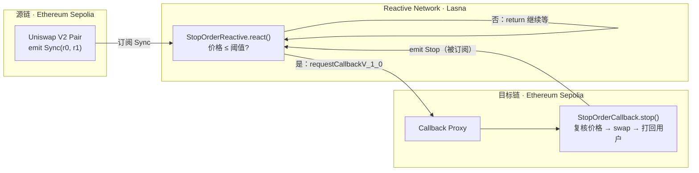

# D1 用例分析：Uniswap V2 链上止损单

> 📅 2026-11-18 ｜ 选用 Reactive 官方生态案例 **Uniswap V2 Stop Order**（[reactive-smart-contract-demos / main / src/demos/uniswap-v2-stop-order](https://github.com/Reactive-Network/reactive-smart-contract-demos/tree/main/src/demos/uniswap-v2-stop-order)）
>
> ⚠️ 官方案例仍是旧版 ReactVM 写法（`vmOnly`、`emit Callback`、`service.subscribe`）。本文分析它的**业务逻辑**，代码片段已按 **Omni 写法**改写（`onlySystem`、`SYSTEM.subscribe`、`requestCallbackV_1_0`），未编译，仅作示意。

---

## 🎯 一句话总结

**盯住 Uniswap V2 交易对的每一次价格变化，价格跌破阈值就自动卖出，用户全程不用盯盘，也不用自己跑机器人。** 对应黑客松赛道 2「Set It and Forget It」（个人自动化）。

| 问题 | 答案 |
|---|---|
| ① 监听什么 | Ethereum Sepolia → Uniswap V2 **Pair 合约** → `Sync(uint112 reserve0, uint112 reserve1)` 事件 |
| ② 什么条件触发 | 由储备量算出的价格 **≤ 用户设定的止损阈值**，并且还没有触发过 |
| ③ 在哪做什么 | 在 Ethereum Sepolia 上回调止损合约的 `stop()`：拉取用户已授权的代币，通过 Uniswap V2 Router 卖出，把换到的币打回给用户 |
| ④ 不用 Reactive 怎么办 | 自己跑一个 7×24 的监听机器人，或者手动盯盘 / 用托管式 keeper 服务（详见第 4 节） |

---

## 🗺️ 简图：源链 → Reactive → 目标链

```
┌──────────────── 源链：Ethereum Sepolia ────────────────┐
│                                                         │
│  有人在 Uniswap V2 做 swap                               │
│        │                                                │
│        ▼                                                │
│  Pair 合约 emit Sync(reserve0, reserve1)  ──────────────┼──┐ ① 订阅的事件
│                                                         │  │
└─────────────────────────────────────────────────────────┘  │
                                                             ▼
┌──────────────── Reactive Network（Lasna） ──────────────────────┐
│                                                                 │
│  SYSTEM(0x8888…8888) 匹配订阅 → 调用 StopOrderReactive.react()  │
│        │                                                        │
│        ├─ 解码 reserve0 / reserve1，计算价格                      │
│        ├─ ② 价格 > 阈值 → return（继续等）                        │
│        └─ ② 价格 ≤ 阈值 且未触发 → triggered = true              │
│                 SYSTEM.requestCallbackV_1_0(stop(...)) ─────────┼──┐
│                                                                 │  │
│  收到 Stop 事件确认后 → done = true（一次性订单结束） ◄───────────┼──┼──┐
└─────────────────────────────────────────────────────────────────┘  │  │
                                                                     ▼  │
┌──────────────── 目标链：Ethereum Sepolia ─────────────────────────┐  │
│                                                                   │  │
│  Callback Proxy 0xAa14…23b4 → StopOrderCallback.stop()            │  │
│        ├─ 再次读取链上储备，确认价格仍 ≤ 阈值                        │  │
│        ├─ transferFrom(用户, 本合约, 已授权额度)                     │  │
│        ├─ ③ Router.swapExactTokensForTokens 卖出                   │  │
│        ├─ 把换到的代币转回用户                                      │  │
│        └─ emit Stop(pair, client, token, amounts) ─────────────────┼──┘
│                                                                   │
└───────────────────────────────────────────────────────────────────┘
```

同一张图的 Mermaid 版本（GitHub 上可以直接渲染）：



---

## 1️⃣ 监听哪条链、哪个合约的什么事件？

| 订阅 | 链 | 合约 | 事件 | topic0 |
|---|---|---|---|---|
| 主订阅：价格变化 | Ethereum Sepolia（`11155111`） | 某个 Uniswap V2 **Pair** | `Sync(uint112,uint112)` | `0x1c411e9a96e071241c2f21f7726b17ae89e3cab4c78be50e062b03a9fffbbad1` |
| 辅助订阅：执行确认 | Ethereum Sepolia | 止损回调合约 | `Stop(address,address,address,uint256[])` | `0x9996f0dd09556ca972123b22cf9f75c3765bc699a1336a85286c7cb8b9889c6b` |

> 两个 topic0 都已用 `cast keccak` 核对。

**为什么选 `Sync` 而不是 `Swap`？**
- Uniswap V2 的 Pair 每次 swap、mint、burn 之后都会 emit `Sync`，`data` 里直接带着**最新的两个储备量**。
- 价格 = 储备量之比，所以**只看这一个事件就能算出当前价格**，不需要再跨链读取状态。
- `Sync` 的两个参数都没有 indexed，因此是 LOG1，参数全在 `data` 里，解码很简单：`abi.decode(log.data, (uint112, uint112))`。

---

## 2️⃣ 满足什么条件时触发？

```
卖 token0 时（token0 = true）： reserve1 × coefficient / reserve0 ≤ threshold
卖 token1 时（token0 = false）：reserve0 × coefficient / reserve1 ≤ threshold
```

| 参数 | 含义 |
|---|---|
| `reserve1 / reserve0` | 1 个 token0 能换多少 token1，即 token0 的价格 |
| `coefficient` | 放大倍数。Solidity 没有小数，先乘上它再做除法，避免精度丢失 |
| `threshold` | 止损价 × `coefficient` |
| `triggered` | 防止价格一直低于阈值时**每个 Sync 都重复发回调** |
| `done` | 收到 `Stop` 确认后置为 true，订单结束 |

**举例：** `coefficient = 1000`、`threshold = 800`，意思是"1 个 token0 的价格跌到 0.8 个 token1 以下就卖"。

Omni 写法的核心逻辑（示意）：

```solidity
function react(LogRecord calldata log_) external onlySystem {
    if (done) return;                                   // 过滤一律 return，不 revert

    // 辅助订阅：止损合约执行完成的确认
    if (log_.contractAddress == stopOrder) {
        if (triggered
            && log_.topic1 == uint256(uint160(pair))
            && log_.topic2 == uint256(uint160(client))) {
            done = true;
            SYSTEM.unsubscribe(SEPOLIA, pair, SYNC_TOPIC_0, REACTIVE_IGNORE, REACTIVE_IGNORE, REACTIVE_IGNORE);
        }
        return;
    }

    // 主订阅：Sync 价格更新
    if (triggered) return;
    (uint112 r0, uint112 r1) = abi.decode(log_.data, (uint112, uint112));
    if (!_belowThreshold(r0, r1)) return;               // 条件不满足，继续等

    triggered = true;
    SYSTEM.requestCallbackV_1_0(ISystemContract.CallbackConfiguration_V_1_0({
        chainId:   SEPOLIA,
        recipient: stopOrder,
        gasLimit:  1_000_000,                            // swap 比较重，给足 gas
        payload:   abi.encodeWithSignature(
            "stop(address,address,address,bool,uint256,uint256)",
            address(0),                                  // 第一个参数占位，由 Proxy 填入本合约地址
            pair, client, token0, coefficient, threshold
        )
    }));
}
```

> 官方旧版代码在 `react()` 开头用了 `assert(!done)`。按 Omni 的计费规则，revert 照样扣费，所以这里改成了 `return`。

---

## 3️⃣ 在哪条链做什么动作？

**目标链：Ethereum Sepolia**（和源链相同；也可以换成别的链，前提是那条链上有对应的交易对）。

回调合约 `stop()` 按顺序做这几件事：

| 步骤 | 动作 | 目的 |
|---|---|---|
| 1 | `onlyServiceProvider` 加 `onlyCallbackSender` 双重校验 | 只接受来自 Proxy、并且是我们自己的 Reactive 合约发起的回调 |
| 2 | 再次 `getReserves()`，确认价格仍然 ≤ 阈值 | 从事件发生到回调执行之间价格可能已经反弹，**链上复核**，避免误卖 |
| 3 | `transferFrom(client → 本合约, allowance)` | 用户事先 `approve` 过多少，就卖多少 |
| 4 | `router.swapExactTokensForTokens(...)` | 在 Uniswap V2 上卖出 |
| 5 | 把买到的代币 `transfer` 回用户 | 合约本身不留资金 |
| 6 | `emit Stop(pair, client, token, amounts)` | 通知 Reactive 合约"已完成"，形成闭环 |

用户唯一要做的准备：**事先对回调合约 `approve` 要卖的代币**，然后就不用管了。

---

## 4️⃣ 不用 Reactive 怎么做？Reactive 简化了什么？代价是什么？

### 不用 Reactive 的三种做法

| 方案 | 做法 | 问题 |
|---|---|---|
| **A. 自己跑机器人** | 在服务器上跑 Node/Python 脚本，通过 WebSocket RPC 订阅 `Sync` → 计算价格 → 用热钱包私钥发交易调用止损合约 | 要 7×24 在线、断线重连、处理链重组；RPC 有费用；**热钱包私钥放在服务器上**；机器人宕机时止损失效，而通常就在行情剧烈的时候最容易出问题 |
| **B. 托管式 keeper（Gelato / Chainlink Automation 等）** | 写 `checkUpkeep()`，由服务商定时轮询，满足条件就执行 | 依赖第三方平台；大多是**轮询**而不是事件驱动，有延迟；跨链需要额外桥接 |
| **C. 手动盯盘** | 自己看价格，跌了就去 Uniswap 卖 | 要人一直在；睡觉、开会时完全失效；反应慢 |

### 🏦 延伸：Binance 的止损/止盈是怎么实现的？

**Binance 的止损/止盈，本质上就是交易所在自家服务器上替所有用户跑的一个 7×24 监听程序。** 价格数据、你的资金、撮合引擎都在 Binance 自己的系统里，所以它能做到即时、免费、几乎没有延迟。但前提是你把钱交给它保管，并且信任它。

Binance 内部的具体实现没有公开，下面是交易所的通用架构：

```
用户下止损单 ──► 条件单系统（存在交易所数据库里，暂不进入订单簿）
                        │
     每一笔成交 / 每次标记价格更新
                        ▼
              触发引擎：最新价是否 ≤ 触发价？
                        │ 是
                        ▼
         转成市价单或限价单 ──► 撮合引擎（订单簿）──► 成交，更新你的账户余额
```

| 组件 | 作用 |
|---|---|
| **条件单系统** | 你设置的止损单先放在这里，订单簿里看不到它，其他人也看不到 |
| **触发引擎** | 撮合引擎每产生一笔成交，都会推送一次价格，引擎检查所有挂着的条件单。合约交易还可以选择按"最新价"或"标记价格"触发 |
| **撮合引擎** | 条件满足后，条件单被转换成普通订单，放进订单簿成交 |
| **账户系统** | 你的币本来就在交易所的账本里，成交只是修改数据库里的数字，**不需要你签名**，也不用上链 |

**为什么交易所能做到，链上却需要机器人或 Reactive？** 关键在于：**智能合约是被动的，它不能自己醒来。**

| | Binance（中心化交易所） | 链上（Uniswap） |
|---|---|---|
| 谁在看价格 | 交易所内部程序，一直在跑 | **没有人**，合约只在有人发交易时才执行 |
| 谁发起卖出 | 交易所直接改账本 | 必须有人**签名并发出一笔交易** |
| 资金在哪 | 交易所托管 | 在你自己的钱包里 |
| 价格和执行 | 在同一个系统里，几乎同步 | 价格来自事件，执行是另一笔交易，有时间差 |
| 费用 | 免费，交易所从手续费里赚 | 每次检查、每笔交易都要付 gas |

所以链上的止损单，必须由某个角色来充当"Binance 的触发引擎"，几种方案的区别就在于这个角色由谁来做：

| 方案 | 谁来做触发引擎 | 信任谁 | 资金托管 |
|---|---|---|---|
| **Binance** | 交易所 | 交易所 | 交易所托管 ❗ |
| **自己跑机器人** | 你的服务器 | 你自己（但服务器上要放私钥） | 自己保管 |
| **Gelato 等 keeper** | 服务商的节点 | 服务商 | 自己保管 |
| **Reactive** | Reactive 网络和你写的合约 | Reactive 验证者，逻辑公开在链上 | 自己保管，只需 `approve` |

> 💡 **Binance = 托管资金 + 内置触发引擎**，体验最好，但钱不在你手里。
> **Reactive = 把"触发引擎"这块搬到链上**，资金留在自己钱包里、逻辑公开可查，代价是按事件付费，并且从触发到执行有几个区块的延迟。
>
> 这也解释了为什么止损单是 Reactive 的典型案例：它补上的正是"中心化交易所自带、而区块链天生缺少的那个常驻触发器"。

### Reactive 让它简单在哪里

| 简化点 | 说明 |
|---|---|
| ✅ **不需要服务器和机器人** | "监听 + 判断 + 发交易"全部写在一个 Solidity 合约里，部署完就完成了 |
| ✅ **事件驱动，不用轮询** | 每个 `Sync` 都会推送给 `react()`，不会因为轮询间隔而错过 |
| ✅ **不需要热钱包私钥** | 回调由 Reactive 网络发出，用户只需要 `approve`，没有私钥常驻服务器的风险 |
| ✅ **逻辑上链、可验证** | 触发条件写在合约里，谁都能审计，不是黑盒脚本 |
| ✅ **天然跨链** | 想在 A 链监听、在 B 链执行，只要改一下回调的 `chainId` 和 Proxy 地址 |

### 代价是什么

| 代价 | 说明 |
|---|---|
| 💸 **每个事件都收费** | 每个 `Sync` 都会触发一次 `react()`，测试网上约 0.015 lREACT 一次。即使价格没跌也要付钱，热门交易对一天可能有成千上万次 swap |
| 💸 **两边都要充值** | Reactive 侧付 REACT，目标链侧回调合约付 ETH，**任何一边欠费都会静默停止**，止损就失效了 |
| ⏱️ **有延迟，不是原子的** | 从源链事件到目标链回调之间隔了几个区块，价格可能继续下跌，也可能反弹。所以回调里必须**复核价格**；同时只能尽量快，不能保证成交价 |
| 🥪 **滑点 / MEV 风险** | 官方示例的 `swapExactTokensForTokens` 用的是 `amountOutMin = 0`，没有滑点保护，容易被夹（sandwich）。实际使用时应该设最小成交量 |
| 🧩 **只能看到事件** | Reactive 合约读不到源链状态，只能依赖事件里携带的数据。`Sync` 恰好带了储备量，换成别的场景可能信息不够 |
| 🐞 **调试链路更长** | 出问题时要分别查源链、Lasna、目标链三处，还要排查欠费、Proxy 地址、gas 余量等问题 |
| 🔗 **信任 Reactive 网络** | 依赖 Reactive 验证者正常运行并如实投递回调 |

### 结论

> 止损单是 Reactive 的**典型适用场景**："条件触发 + 无人值守 + 不想托管私钥"。去掉 Reactive 后必须引入一个**中心化、常驻在线、持有私钥**的机器人，而 Reactive 把这个角色换成了链上合约。代价是**按事件计费**和**非原子执行**，所以要选事件频率合适的交易对，并在回调里复核价格、加上滑点保护。

---

## 🔗 参考链接

- 官方案例代码（旧版写法）：https://github.com/Reactive-Network/reactive-smart-contract-demos/tree/main/src/demos/uniswap-v2-stop-order
- Omni 写法：https://dev.reactive.network/reactive-contracts ・ https://dev.reactive.network/callback-contracts
- 费用模型：https://dev.reactive.network/economy
- Callback Proxy 地址：https://dev.reactive.network/origins-and-destinations
