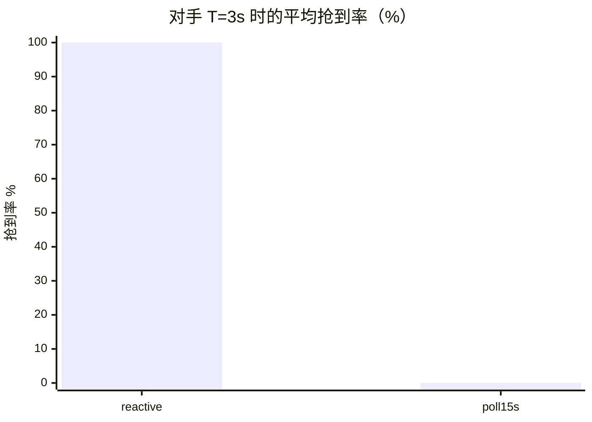
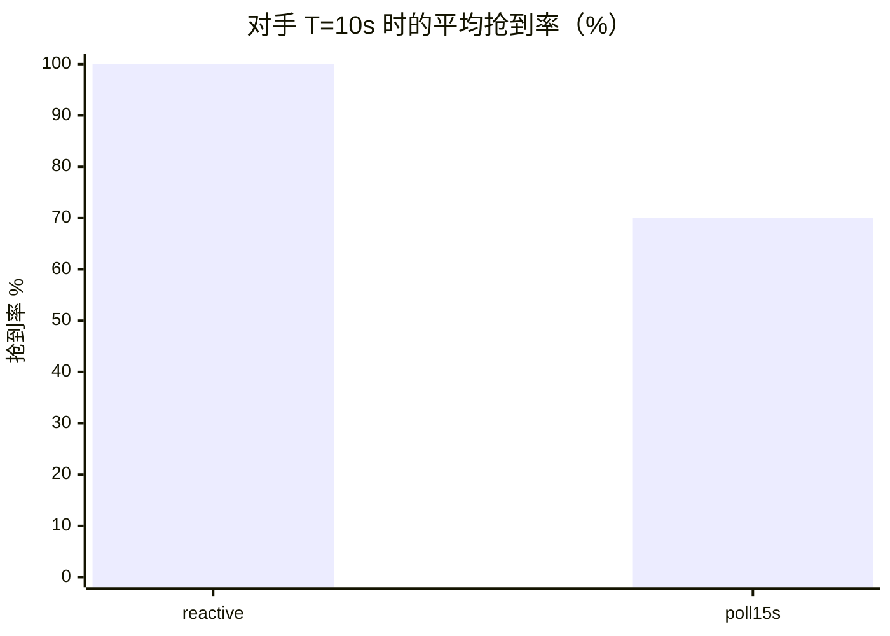
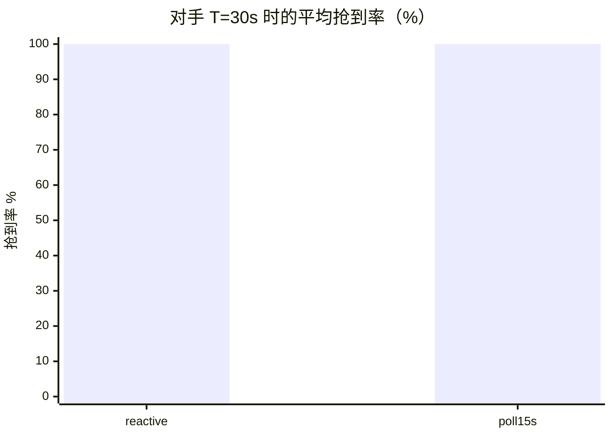

# 📊 实验报告（自动生成，请勿手改）

> 生成时间：2026-11-28T08:05:22.289Z · 数据目录：`bench/results`
> **主指标 = Base 区块差 × 200ms**（同一条链、精度 0.2s）。整秒时间戳精度 ±1s；跨链单段受两条链时钟偏差影响，可能为负，仅供参考；链下毫秒含公共 RPC 往返，只作参考。

## 1. 端到端延迟（Reactive Omni）：还款 → Lasna react → Base 回调

样本 30 个（超时 0 个）。P95 用 nearest-rank，n 较小时不稳定。

| 指标 | 中位数 | P95 | 最小 | 最大 |
|---|---|---|---|---|
| ⭐ Base 区块差（块） | 5 | 8 | 3 | 8 |
| ⭐ 链上 E2E ≈ 区块差 × 0.2（秒） | 1.0 | 1.6 | 0.6 | 1.6 |
| 链上 E2E，整秒时间戳（秒，±1s） | 1.0 | 2.0 | 0.0 | 2.0 |
| Base → Lasna，跨链时间戳（秒，仅参考） | -1.0 | 0.0 | -2.0 | 0.0 |
| Lasna → Base，跨链时间戳（秒，仅参考） | 2.0 | 2.0 | 1.0 | 2.0 |
| 链下 E2E，脚本观察（毫秒，含 RPC） | 5127.0 | 7242.0 | 605.0 | 8820.0 |

> 1 个样本缺 Lasna 段：脚本看到回调后只查了一次 Lasna，公共 RPC 当时还没索引到日志（react 本身存在）。不影响 E2E。

前 3 个样本的浏览器链接：

- 还款 [0x87056af3…](https://sepolia.basescan.org/tx/0x87056af304ec2c103c1897cb6efed08d0427b215dc69e3ccfa7e22acbaddf00b) → react [0x91113ef3…](https://lasna.reactscan.net/tx/0x91113ef37e4326e4c160f99cb5712d856dc846019a04fd0eedfe3b777b1d9b54) → 回调 [0xc3bb14d1…](https://sepolia.basescan.org/tx/0xc3bb14d1ca79e22395ab1844cd65a4f0117afab03c2f0d311755d53657419d51)（8 块）
- 还款 [0x75aff3b1…](https://sepolia.basescan.org/tx/0x75aff3b1e225c4f1d59f43d23140056eb7c23bb34a085db3de5f36fbbbda4151) → react [0x4e6a22ee…](https://lasna.reactscan.net/tx/0x4e6a22eed629c1533fa24d184534c8b573774ca0f7aedfbb4cef4f51d25122a0) → 回调 [0x5a4a7f96…](https://sepolia.basescan.org/tx/0x5a4a7f962c62d02d4c7bdb4777f8bee17acc1374aed5b99d12fa134ade0a1503)（7 块）
- 还款 [0x8af9a458…](https://sepolia.basescan.org/tx/0x8af9a458dcac8e847bed273d4b84685d073a2eb7b08afb4021cae3a178e296b3) → react [0x017bb2de…](https://lasna.reactscan.net/tx/0x017bb2deed46fff3a973bf937853683bf36e9ddad15aac758f53d6d16c4c8e26) → 回调 [0x20302a4d…](https://sepolia.basescan.org/tx/0x20302a4db4a228bfdbc378828d4f22a011174c363f88096ac5e89ab9df39721e)（5 块）

## 2. 抢流动性实验：还款后，金库和对手谁先从池子取走这笔流动性

**平均抢到率**（金库取回 ÷ 还款金额；括号内为样本数，「—」表示还没跑）

| 方案 | 对手 T=3s | 对手 T=10s | 对手 T=30s |
|---|---|---|---|
| reactive（实测） | 100%（10） | 100%（10） | 100%（10） |
| poll15s（实测） | 0%（10） | 70%（10） | 100%（10） |
| 旧版约 7s 出块（**推算**，k=2） | 0% | 0% | 100% |

> 推算方法：实测链上 E2E（区块差口径）每个样本加上 k × (7 − 1) = 12 秒，小于 T 记为抢到。是推算，不是实测。

**我方取回耗时**（还款交易 → 金库从池子取回交易，⭐ 链上区块差；中位数）

| 方案 | T=3s | T=10s | T=30s |
|---|---|---|---|
| reactive | 6 块 ≈ 1.20s（n=10） | 5.5 块 ≈ 1.10s（n=10） | 5.5 块 ≈ 1.10s（n=10） |
| poll15s | — | 40 块 ≈ 8.00s（n=7） | 35.5 块 ≈ 7.10s（n=10） |

参考：脚本通过公共 RPC 看到取回交易的链下耗时中位数（毫秒，含 RPC 往返，比链上慢约 4 秒）

| 方案 | T=3s | T=10s | T=30s |
|---|---|---|---|
| reactive | 5134.0 | 5210.5 | 5255.5 |
| poll15s | — | 9765.0 | 9767.0 |

**轮询组：抢到率 × 还款时距下一次轮询的等待时间**（相位已随机化）

| T | 0–3s | 3–6s | 6–9s | 9–12s | 12–15s |
|---|---|---|---|---|---|
| 3s | — | 0%（3） | 0%（1） | 0%（4） | 0%（2） |
| 10s | 100%（2） | 100%（2） | 100%（3） | 0%（1） | 0%（2） |
| 30s | 100%（1） | 100%（6） | 100%（2） | — | 100%（1） |

## 3. 解读规则（实验前写定，见方案文档 9.5）

- Omni 在 T ≥ X 秒时稳定抢到，而旧版推算和轮询在同样的 T 下抢不到 → 证明存在只有 Omni 级速度能进入的时间窗口。
- Omni 与轮询 15s 差别不大 → 如实报告，把 T 调小再测，或分析瓶颈在哪一段。
- 局限：对手延迟 T 是人为设定的，只证明相对时间窗口；同区块 MEV 抢跑不在比较范围内。
